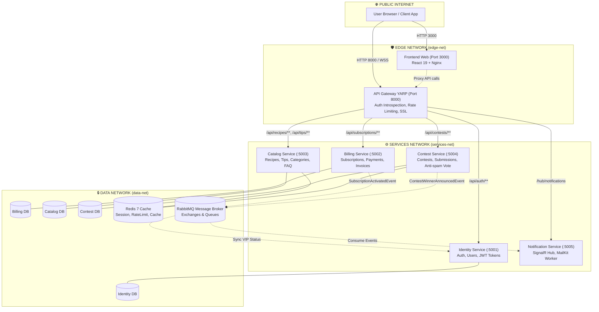

# 🏗️ BẢN THIẾT KẾ & KẾ HOẠCH TRIỂN KHAI MICROSERVICES + DOCKER CHUẨN PRODUCTION
## Dự án: James Thew Culinary Excellence Platform
### Tài liệu kỹ thuật cấp cao dành cho Ban Kiến Trúc & Đội Ngũ Phát Triển (Senior Developer Blueprint)

---

## 🎯 1. ĐÁNH GIÁ HIỆN TRẠNG KIẾN TRÚC (CURRENT STATE ASSESSMENT)

### 1.1. Những điểm đã làm tốt (Current Strengths)
1. **Lớp Gateway tiền đề:** Đã có `JamesThew.Gateway` sử dụng YARP .NET 10 (Port 8000) làm điểm đón nhận duy nhất (Single Point of Entry), đã cấu hình Middleware truyền nhận Header (`X-User-Id`, `X-User-Role`, `X-Subscription-Active`).
2. **Đóng gói Docker cơ bản:** Đã có `Dockerfile` multi-stage cho Backend (.NET 10 Alpine non-root `USER app`) và Frontend (Node build + Nginx Alpine).
3. **Cơ cấu Codebase sạch:** Đã hoàn tất refactor SOLID (SRP cho 12 Entities riêng biệt, ISP/DIP cho tầng Service và Repository Interfaces, có sẵn `JamesThew.Shared.Contracts`).
4. **Bảo mật cổng nội bộ:** Cổng Backend 5000 đã được gỡ bỏ mapping ra host ngoài `docker-compose.yml`, chỉ giữ lại `expose: 5000` nội bộ.

### 1.2. Những điểm nghẽn & Anti-Patterns cần khắc phục để đạt chuẩn Microservices
| Hiện trạng (Monolith / Dev mode) | Vấn đề / Rủi ro Kỹ thuật | Chuẩn Microservices Production mục tiêu |
| :--- | :--- | :--- |
| **Shared Database:** Toàn bộ entities dùng chung 1 database `JamesThewDb`. | Vi phạm nghiêm trọng nguyên tắc *Database-per-Service*. Thay đổi schema 1 bảng có thể làm sập toàn bộ các module khác; nghẽn kết nối I/O. | **Database-per-Service:** Mỗi microservice sở hữu CSDL riêng biệt (`IdentityDb`, `CatalogDb`, `ContestDb`, `BillingDb`). Giao tiếp liên service qua Async Event Bus. |
| **Lộ cổng hạ tầng ra Host:** `docker-compose.yml` đang map port SQL Server (`1433:1433`), Redis (`6379:6379`), RabbitMQ (`5672:5672`). | Nguy cơ quét cổng brute-force mật khẩu sa/guest từ Internet; vi phạm nguyên tắc Defense-in-Depth. | **Zero-Public Data Ports:** Các container database và message broker chỉ lắng nghe trong mạng nội bộ Docker. Chỉ mở Port 80/443 (hoặc 8000/3000 ở môi trường dev). |
| **Mạng Docker phẳng (Single Bridge Network):** Toàn bộ frontend, backend, database nằm chung `jamesthew-internal-net`. | Nếu container frontend hoặc Nginx bị chiếm quyền kiểm soát (RCE), hacker có thể truy cập thẳng vào database port 1433. | **Network Segmentation 3 Tầng:** Phân tách thành `edge-net` (Frontend - Gateway), `services-net` (Gateway - Microservices), và `data-net` (Microservices - SQL, Redis, RabbitMQ). |
| **Thiếu Resource Limits:** Chưa giới hạn CPU và Memory trong Docker Compose. | Hiện tượng "Noisy Neighbor" — một query nặng hoặc memory leak có thể ngốn 100% tài nguyên host, làm sập toàn bộ các container khác. | **Explicit Resource Constraints:** Định nghĩa `cpus: "0.5"` - `"1.5"` và `memory: 256M` - `512M` cho từng service. |
| **Thiếu Circuit Breaker & Resiliency:** Gọi giữa các service chưa có cơ chế phòng vệ đổ vỡ dây chuyền. | Nếu Notification hoặc Billing service bị treo, các request từ Gateway hoặc Catalog có thể bị nghẽn thread pool làm tê liệt cả hệ thống. | **Resilience Mesh (Polly):** Áp dụng Retry with Exponential Backoff, Circuit Breaker, Timeout, Bulkhead Isolation. |
| **Thiếu Distributed Tracing:** Chưa có Correlation ID xuyên suốt qua Gateway xuống Microservices và Async Queue. | Khó khăn khi debug lỗi giao dịch phân tán (Saga); không đo lường được latency từng chặng. | **OpenTelemetry + W3C TraceContext:** Tự động sinh `traceparent` tại Gateway, forward qua headers và message broker, log tập trung về Seq/Loki. |

---

## 🏛️ 2. MÔ HÌNH KIẾN TRÚC ĐÍCH (TARGET ARCHITECTURE TOPOLOGY)



---

## 📦 3. TIÊU CHUẨN DOCKER DOANH NGHIỆP (THE 7 GOLDEN DOCKER STANDARDS)

### 3.1. Phân Tách Môi Trường Docker Compose (Compose File Separation)
Tuyệt đối không dùng 1 file compose duy nhất cho cả Dev và Prod. Cần áp dụng chuẩn:
- `docker-compose.yml`: Định nghĩa khung sườn (Services, Dockerfile contexts, internal networks, named volumes).
- `docker-compose.override.yml`: (Dành riêng cho Local Dev, được Git ignore hoặc dùng mẫu `.dev.yml`): Mở port debug 1433, 6379, 15672, mount hot-reload volume.
- `docker-compose.prod.yml`: (Dành cho Production): Hardening bảo mật, không mở port DB, cấu hình resource limits, log driver quay vòng.

### 3.2. Cấu Hình docker-compose.prod.yml Mẫu Chuẩn

```yaml
version: '3.8'

services:
  gateway:
    image: jamesthew-gateway:latest
    build:
      context: .
      dockerfile: gateway/Dockerfile
    container_name: jamesthew-gateway
    restart: always
    ports:
      - "8000:8000"
    environment:
      - ASPNETCORE_ENVIRONMENT=Production
      - ASPNETCORE_URLS=http://+:8000
    networks:
      - edge-net
      - services-net
    deploy:
      resources:
        limits:
          cpus: '1.0'
          memory: 512M
    logging:
      driver: "json-file"
      options:
        max-size: "10m"
        max-file: "3"

  service-catalog:
    image: jamesthew-catalog:latest
    build:
      context: .
      dockerfile: services/catalog/Dockerfile
    container_name: jamesthew-service-catalog
    restart: unless-stopped
    expose:
      - "5003"
    environment:
      - ASPNETCORE_ENVIRONMENT=Production
      - ConnectionStrings__DefaultConnection=Server=sqlserver,1433;Database=JamesThew_CatalogDb;User Id=sa;Password=${SQL_PASSWORD};TrustServerCertificate=True;
      - Redis__ConnectionString=redis:6379
    networks:
      - services-net
      - data-net
    deploy:
      resources:
        limits:
          cpus: '1.5'
          memory: 768M

  sqlserver:
    image: mcr.microsoft.com/mssql/server:2022-latest
    container_name: jamesthew-sqlserver
    restart: always
    environment:
      - ACCEPT_EULA=Y
      - MSSQL_SA_PASSWORD=${SQL_PASSWORD}
    # TUYỆT ĐỐI KHÔNG ports 1433:1433 Ở PRODUCTION
    expose:
      - "1433"
    volumes:
      - sqlserver_data:/var/opt/mssql/data
    networks:
      - data-net
    deploy:
      resources:
        limits:
          cpus: '2.0'
          memory: 2048M

networks:
  edge-net:
    driver: bridge
  services-net:
    driver: bridge
    internal: false
  data-net:
    driver: bridge
    internal: true # Không có route ra Internet, bảo mật tuyệt đối

volumes:
  sqlserver_data:
  redis_data:
  rabbitmq_data:
```

### 3.3. Các Tiêu Chuẩn Dockerfile Bắt Buộc
1. **Multi-Stage Build:** Tách riêng stage `build` (chứa .NET SDK, Node SDK) và stage `runtime` (chỉ chứa .NET runtime Alpine / Nginx minimal).
2. **Non-Root Execution (`USER app`):** Đảm bảo container không chạy dưới quyền `root` của máy chủ Linux để chống kỹ thuật container escape.
3. **Log Rotation:** Giới hạn file log tối đa 10MB x 3 file để tránh hiện tượng log làm tràn ổ cứng máy chủ VPS/Cloud.
4. **Health Check Probes:** Tích hợp kiểm tra sức khỏe cả ở mức Database, Redis, RabbitMQ và ASP.NET Core `/health` endpoint trước khi cho phép Gateway điều hướng request đến.

---

## 🗺️ 4. LỘ TRÌNH 5 GIAI ĐOẠN TRIỂN KHAI (5-PHASE STRANGLER FIG ROADMAP)

```
[Hiện Tại: Modular Monolith + YARP Gateway]
                       │
                       ▼
    Sprint 1: Phân tầng Docker Network & Quản lý Cấu hình Secret
                       │
                       ▼
    Sprint 2: Bóc tách Bounded Context 1 & 2 (Identity & Billing)
                       │
                       ▼
    Sprint 3: Bóc tách Bounded Context 3 & 4 (Catalog & Contest)
                       │
                       ▼
    Sprint 4: Hoàn thiện Event Bus (RabbitMQ + MassTransit + Outbox)
                       │
                       ▼
    Sprint 5: Tích hợp Observability (OpenTelemetry) & Load Testing (k6)
                       │
                       ▼
[Mục Tiêu: Cụm Microservices Chuẩn Doanh Nghiệp Hoàn Chỉnh]
```

---

### 🔹 Sprint 1: Chuẩn Hóa Hạ Tầng Docker & Mạng Bảo Mật (Week 1)
- **Mục tiêu:** Tách mạng Docker thành 3 phân vùng (`edge-net`, `services-net`, `data-net`).
- **Nhiệm vụ:**
  1. Cập nhật `docker-compose.yml` phân tách mạng rõ ràng.
  2. Tạo file mẫu `.env.example` và quy chế quản lý mật khẩu strong password (trên 16 ký tự, gồm chữ hoa, số, ký tự đặc biệt).
  3. Cấu hình log rotation (`json-file`, `max-size: 10m`) cho toàn bộ container.
  4. Đóng cổng công khai của SQL Server, Redis, RabbitMQ; chỉ cho phép Gateway và Frontend nhận traffic ngoài.
- **Tiêu chí nghiệm thu:** `docker compose up -d` hoạt động ổn định, quét cổng từ bên ngoài không thấy port 1433, 6379.

---

### 🔹 Sprint 2: Bóc Tách Identity Service & Billing Service (Week 2)
- **Mục tiêu:** Tách 2 phân hệ nhạy cảm nhất liên quan đến người dùng và tiền tệ.
- **Nhiệm vụ:**
  1. Tạo project `services/JamesThew.Service.Identity`: Sở hữu bảng `Users`, cấp JWT token và xử lý Profile.
  2. Tạo project `services/JamesThew.Service.Billing`: Sở hữu bảng `Subscriptions`, `Payments`.
  3. Tách database: `JamesThew_IdentityDb` và `JamesThew_BillingDb`.
  4. Cập nhật routing trong YARP Gateway:
     - `/api/auth/**`, `/api/users/**` ➔ `http://service-identity:5001`
     - `/api/subscriptions/**`, `/api/payments/**` ➔ `http://service-billing:5002`
- **Tiêu chí nghiệm thu:** Đăng ký, đăng nhập và thanh toán gia hạn thành viên chạy trơn tru qua Gateway.

---

### 🔹 Sprint 3: Bóc Tách Culinary Catalog & Contest Service (Week 3)
- **Mục tiêu:** Tách phần lõi nội dung món ăn và phân hệ bình chọn cuộc thi.
- **Nhiệm vụ:**
  1. Tạo `services/JamesThew.Service.Catalog`: Quản lý `Recipes`, `Tips`, `Categories`, `Faqs`.
  2. Tích hợp Redis Caching: Cache danh mục và các công thức `IsFree == true` với TTL 15 phút.
  3. Tạo `services/JamesThew.Service.Contest`: Quản lý `Contests`, `ContestEntries`, `ContestVotes`.
  4. Triển khai cơ chế chống gian lận bình chọn: Dùng Redis Set `{contestId}:{entryId}:{userId_or_ip}` chặn spam vote.
  5. Cập nhật YARP routes:
     - `/api/recipes/**`, `/api/tips/**`, `/api/categories/**`, `/api/faqs/**` ➔ `http://service-catalog:5003`
     - `/api/contests/**` ➔ `http://service-contest:5004`
- **Tiêu chí nghiệm thu:** Lọc bài Free/VIP đúng quyền hạn, nộp bài thi cho cả Guest và Member thành công.

---

### 🔹 Sprint 4: Thiết Lập Event-Driven Backbone & Transactional Outbox (Week 4)
- **Mục tiêu:** Đồng bộ trạng thái giữa các service không qua gọi trực tiếp (Loose Coupling).
- **Nhiệm vụ:**
  1. Cấu hình **MassTransit** kết nối RabbitMQ trong các service.
  2. Triển khai **Transactional Outbox Pattern**:
     - Khi Member thanh toán thành công tại `Billing Service`: Lưu `OutboxMessage` trong cùng database transaction.
     - Background Worker đọc Outbox và đẩy `SubscriptionActivatedEvent` lên RabbitMQ.
     - `Identity Service` tiêu thụ event, cập nhật quyền hạn `MEMBER` và ngày hết hạn `SubscriptionEndDate`.
  3. Tách `Notification Service`: Đón sự kiện công bố giải (`ContestWinnerAnnouncedEvent`) để gửi Email và push thông báo SignalR.
- **Tiêu chí nghiệm thu:** Quá trình kích hoạt hội viên và thông báo kết quả cuộc thi diễn ra bất đồng bộ và tin cậy 100%, không bị mất message khi một service khởi động lại.

---

### 🔹 Sprint 5: Resilience Mesh, Observability & Tải Thực Tế (Week 5)
- **Mục tiêu:** Đo kiểm hiệu năng và phòng thủ lỗi.
- **Nhiệm vụ:**
  1. Cấu hình **Polly Policies** tại Gateway và HttpClients: Retry (3 lần), Circuit Breaker (ngắt 30s nếu tỷ lệ lỗi > 50%).
  2. Bổ sung **OpenTelemetry**: Tự động sinh `X-Correlation-Id` và header W3C `traceparent` cho mọi request.
  3. Viết kịch bản kiểm thử tải bằng **k6**:
     - Test 500 Virtual Users đồng thời truy cập Catalog.
     - Test Spike 1000 requests nộp bài thi và vote cuộc thi.
- **Tiêu chí nghiệm thu:** $P_{95} < 200\text{ ms}$, không có tình trạng cascading failure khi mô phỏng tắt 1 microservice phụ.

---

## 🛠️ 5. MA TRẬN KỸ THUẬT & DANH MỤC CÔNG NGHỆ CHUẨN HOÁ

| Hạng mục | Công nghệ lựa chọn | Lý do kỹ thuật (Senior Dev Rationale) |
| :--- | :--- | :--- |
| **Ingress / Reverse Proxy** | **YARP (.NET 10)** | Tận dụng hiệu năng cao của Kestrel, tích hợp sâu với C#, dễ viết custom middleware kiểm tra quyền và forward header claims. |
| **Backend Runtime** | **.NET 10 LTS (Alpine)** | Kích thước container siêu nhẹ (<130MB), tốc độ khởi động nhanh (<1.5s), hiệu năng top-tier TechEmpower benchmarks. |
| **Message Broker** | **RabbitMQ 3.13 Alpine + MassTransit** | Hỗ trợ AMQP 0-9-1/1.0 chuẩn hóa, dễ dàng cấu hình Exchanges (Topic/Fanout), Dead-Letter Queues và Outbox Pattern qua MassTransit. |
| **Distributed Caching** | **Redis 7 Alpine** | Lưu trữ in-memory tốc độ sub-millisecond, hỗ trợ atomic counters cho vote và distributed locks khi cần. |
| **Database** | **SQL Server 2022 (Linux Container)** | Phù hợp đề bài Aptech, hỗ trợ transaction ACID chuẩn mực cho bảng tài chính và nghiệp vụ cốt lõi. |
| **Frontend Server** | **Nginx Alpine + React 19** | Phục vụ static assets với HTTP/2, Gzip compression, client-side routing fallback không gây lỗi 404. |
| **Testing Automation** | **xUnit + Vitest + k6** | Kiểm thử đa tầng: Backend Integration Tests, Frontend Component Tests, và Performance Benchmarks. |

---

## 📋 6. KẾT LUẬN & ĐỀ XUẤT HÀNH ĐỘNG TỨC THÌ

Là một Senior Developer, lời khuyên cốt lõi là **không chuyển dịch vội vã theo kiểu đập đi làm lại**. Hiện tại, dự án James Thew đã có cấu trúc Entity, DTO, Repository và Gateway rất tốt theo đúng chuẩn SOLID.

### 3 Hành động ưu tiên triển khai ngay:
1. **Hardening Docker Compose ngay tại cấu hình hiện tại:** Đóng toàn bộ port database ra ngoài Internet, phân vùng `networks`, thêm resource limits.
2. **Tách Solution Projects:** Tạo các thư mục dự án con trong solution cho `Identity` và `Catalog` trước, giữ nguyên Shared Contracts.
3. **Giữ vững 158 automated tests:** Đảm bảo mỗi bước tách nhỏ (Sprint) đều pass 100% tests trước khi bước sang sprint tiếp theo.

