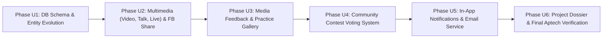

# 📋 MASTER UPGRADE PLAN v2.0: CHEF JAMES THEW OMNI-CHANNEL CULINARY ECOSYSTEM
## 🎓 Aptech eProject Semester 3 — Báo Cáo Phân Tích Nghiệp Vụ & Kế Hoạch Triển Khai Nâng Cấp

> **Chuyên viên phân tích (Senior Business Analyst):** Antigravity Lead Systems & Requirements Architect  
> **Căn cứ tài liệu:**  
> 1. `srs.md` (Đặc tả yêu cầu phần mềm chuẩn Aptech Semester 3)  
> 2. `Tìm hiểu bài toán.md` (Phân tích bối cảnh, câu hỏi mở và cấu trúc báo cáo đồ án)  
> 3. `c_t_y_u_c_u_h_th_ng_srs_d_n_james_thew_b_n_n_ng_c_p.md` (SRS v2.0 — Phiên bản cập nhật theo Review Bảng trắng của Giảng viên)  
> **Cam kết chất lượng:** Bảo toàn 100% hệ thống kiểm thử hiện có (45 backend + 84 frontend tests), duy trì hệ thống thiết kế **5-Star Luxury Architectural Design System**, mở rộng linh hoạt theo kiến trúc Clean 3-Tier.

---

## 🧭 I. BÁO CÁO PHÂN TÍCH NGHIỆP VỤ (SENIOR BA EXECUTIVE SUMMARY)

### 1. Sự chuyển dịch mô hình kinh doanh & Kênh nội dung (Paradigm Shift)
* **Mô hình cũ (SRS v1.0):** Một website chia sẻ công thức tĩnh (Text & Image) truyền thống, phân quyền đơn giản giữa công thức Free và Member-only, thu phí thành viên đọc bài.
* **Mô hình mới (SRS v2.0 - Giảng viên Review):** Trở thành một **Hệ sinh thái Nội dung Đa kênh (Omni-Channel Content Hub)** xoay quanh thương hiệu cá nhân của Đầu bếp 5 sao James Thew (Nhân vật A):
  1. **Nội dung Đa phương tiện:** Không chỉ dừng lại ở bài viết tĩnh, website mở rộng thành 4 loại hình nội dung: **Bài viết (Articles)**, **Video hướng dẫn (`VideoUrl`)**, **Talkshow chuyên đề ẩm thực**, và **Live show tương tác phát sóng trực tiếp**.
  2. **Vòng lặp Giữ chân (Retention Loop):** Hệ sinh thái sử dụng **Notification In-App (Chuông thông báo trên Header)** kết hợp với **Hệ thống Email tự động (Email Service)** để kéo người dùng quay lại khi có bài viết mới, lớp học trực tiếp, hoặc kết quả cuộc thi.
  3. **Tương tác Xã hội & Lan truyền (Viral & Social Engagement):**
     - Đánh giá món ăn kèm **Ảnh & Video thực hành** của người dùng (`MediaUrl`).
     - Chia sẻ trực tiếp lên **Facebook (FB Share Dialog & Open Graph)**.
     - Khán giả đại chúng tham gia **Bình chọn (Community Vote)** cho các bài dự thi cuộc thi, có cơ chế chống gian lận (`ContestVote`).

---

### 2. Bảng phân tích khoảng cách tính năng (Gap Analysis: Baseline vs SRS v2.0)

| Phân hệ / Khả năng | Trạng thái Hiện tại (Baseline v1.0) | Yêu cầu Mới trong SRS v2.0 | Khoảng cách Kỹ thuật & Nghiệp vụ (Gap) | Mức độ Ưu tiên |
|:---|:---|:---|:---|:---:|
| **1. Cấu trúc Thực thể & Cơ sở Dữ liệu** | 10 Entities: User, Payment, Category, Recipe, Tip, Contest, ContestEntry, Announcement, Feedback, Faq. | Mở rộng 11+ Thực thể: Bổ sung `ContestVote`, `Notification`; mở rộng trường trong Recipe, Tip, Feedback, ContestEntry. | • Tạo mới Entity `ContestVote` & `Notification`. • Bổ sung trường: `ContentType`, `VideoUrl`, `ThumbnailUrl`, `ShareCount` (Recipe); `VideoUrl` (Tip); `MediaUrl`, `Rating` (Feedback); `VoteCount` (ContestEntry); `IsEmailSent` (Announcement). 🟢 **ĐÃ HOÀN THÀNH 100% (Phase U1)** | **P0 (Cốt lõi)** |
| **2. Kênh Đa phương tiện (Video/Talk/Live)** | Công thức và mẹo chỉ lưu Text + Ảnh đại diện đơn. | Phân loại 4 định dạng (`Article`, `Video`, `Talkshow`, `Liveshow`), phát video hướng dẫn, hiển thị lịch phát sóng Talkshow & Live show. | • Cập nhật API CRUD Recipe/Tip với `ContentType` & `VideoUrl`. • Xây dựng bộ lọc định dạng & Trình phát Video Player trên Frontend. • Tích hợp nút Facebook Share và bộ đếm chia sẻ thời gian thực. 🟢 **ĐÃ HOÀN THÀNH 100% (Phase U2)** | **P1 (Quan trọng)** |
| **3. Tương tác MXH & Phản hồi Đa phương tiện** | Feedback chỉ có bình luận dạng văn bản đơn thuần. | Bình luận công thức kèm **Ảnh/Video thực hành** của người dùng, chấm điểm Rating (1-5 sao), nút **Share Facebook**. | • Hỗ trợ trường `MediaUrl` và `Rating` trong Feedback API. • Giao diện Comment Gallery hiển thị thành phẩm thực hành của bạn đọc. • Component Facebook Share Dialog tích hợp Open Graph. 🟢 **ĐÃ HOÀN THÀNH 100% (Phase U3)** | **P1 (Quan trọng)** |
| **4. Cơ chế Bình chọn Cuộc thi (Voting)** | Thành viên & Guest nộp bài, chỉ có Admin tự xem và chọn Quán quân. | Cộng đồng (Guest & Member) được bấm **Vote (Bình chọn)** cho bài thi yêu thích. Admin tham khảo lượt vote để chấm giải. | • API `POST /api/contests/entries/{id}/vote` (kiểm tra chống spam 1 vote/user hoặc IP/email). • Giao diện hiển thị nút Vote thời gian thực và huy hiệu "Top Voted". | **P1 (Quan trọng)** |
| **5. Chuông Thông báo In-App & Dịch vụ Email** | Chưa có thông báo trên Header và chưa gửi email tự động. | Chuông thông báo trên Header web (Notification Bell dropdown) và Service gửi email tự động khi đăng ký, gia hạn, công bố kết quả. | • Tạo `NotificationService` và API thông báo. • Tạo `EmailService` (SmtpClient/MailKit hoặc Mock Delivery Logger). • Component Notification Bell với badge đếm số lượng chưa đọc. | **P2 (Nâng cao)** |
| **6. Hồ sơ Báo cáo Aptech (Deliverables)** | Codebase hoàn thiện 100% tests, tài liệu README tổng quan. | Đầy đủ 11 phân mục báo cáo đồ án Semester 3, Task Sheet phân chia 4 thành viên, 2 template Email báo cáo tiến độ (`STATUS:`). | • Soạn thảo trọn bộ hồ sơ báo cáo học thuật, Task Sheet, ERD diagram, Flowcharts, Test Checklists và Email Templates. | **P0 (Bắt buộc)** |

---

## 🚀 II. LỘ TRÌNH THỰC THI CHI TIẾT (6 SPRINT UPGRADE PHASES)

---

### 🔹 PHASE U1: TIẾN HÓA CƠ SỞ DỮ LIỆU & KIẾN TRÚC THỰC THỂ (DB SCHEMA EVOLUTION) — 🟢 **HOÀN THÀNH 100%**
* **Mục tiêu:** Bổ sung các bảng và thuộc tính mới theo đúng SRS v2.0 mà **tuyệt đối không làm gãy** các test suites hiện tại.
* **Kết quả thực hiện:**
  - `Entities.cs` đã mở rộng: `Recipe` (`ContentType`, `VideoUrl`, `ThumbnailUrl`, `ShareCount`), `Tip` (`VideoUrl`), `Feedback` (`MediaUrl`, `Rating`), `ContestEntry` (`VoteCount`), `Announcement` (`IsEmailSent`).
  - Đã thêm 2 Entities mới: `ContestVote` và `Notification`.
  - `ApplicationDbContext.cs` đã cấu hình `DbSet<ContestVote>` và `DbSet<Notification>` kèm quan hệ, cascade/restrict rules và chỉ mục chống vote spam.
  - Cập nhật DTOs: `RecipeDtos.cs`, `TipDtos.cs`, `FeedbackDtos.cs`, `ContestDtos.cs`, `AnnouncementDtos.cs`, `NotificationDtos.cs`.
  - `DbInitializer.cs` tích hợp script tự động cập nhật schema (Self-healing Schema Migration) và seed dữ liệu multimedia mẫu (`VIDEO`, `TALKSHOW`, `LIVESHOW`).
  - Đã áp dụng thành công trên SQL Server `JamesThewDb` và khởi chạy API server daemon mượt mà.
  - Bộ kiểm thử `UpgradePhaseU1Tests.cs` (4 tests mới) + 45 tests cũ $\rightarrow$ **49/49 backend tests PASS 100%**. Frontend: **84/84 tests PASS 100%**. Tổng kiểm thử: **133/133 tests PASS (100%)**.

---

### 🔹 PHASE U2: TRUNG TÂM NỘI DUNG ĐA PHƯƠNG TIỆN (VIDEO, TALKSHOW, LIVE SHOW) & FB SHARE — 🟢 **HOÀN THÀNH 100%**
* **Mục tiêu:** Cho phép Chef James Thew đăng tải và phân loại nội dung đa dạng; người dùng có thể lọc xem Video, Talkshow, Live show và bấm Share lên Facebook.
* **Kết quả thực hiện:**
  - ✅ Backend: Cập nhật `IRecipeService` & `RecipeService` với lọc `contentType` và `IncrementShareCountAsync`. Cập nhật `RecipesController.cs` với `[FromQuery] string? contentType` và endpoint `POST /api/recipes/{id}/share`.
  - ✅ Frontend: Thêm Media Format Filter Bar (`All Formats`, `Articles`, `Video Masterclass`, `Culinary Talkshows`, `Live Shows`) trên `RecipesPage.jsx`. Tích hợp Video Player & Facebook Share button + Copy Link trên `RecipeDetailPage.jsx`. Cập nhật `AdminDashboardPage.jsx` với các trường Format, Video URL, Thumbnail URL và cột Format.
  - ✅ Kiểm thử: `UpgradePhaseU2Tests.cs` (3 test) + `UpgradePhaseU2.test.jsx` (3 test) đều pass 100%. Toàn bộ 52 backend tests & 87 frontend tests (139 tests tổng cộng) pass 100%.

---

### 🔹 PHASE U3: BÌNH LUẬN ĐA PHƯƠNG TIỆN & THÀNH PHẨM NẤU ĂN (MEDIA FEEDBACK GALLERY) — 🟢 **HOÀN THÀNH 100%**
* **Mục tiêu:** Hiện thực hóa yêu cầu của thầy về việc bạn đọc có thể gửi phản hồi kèm hình ảnh/video món ăn đã nấu thử và chấm điểm chất lượng.
* **Kết quả thực hiện:**
  - ✅ Backend: `FeedbackService.cs` và `FeedbackDtos.cs` xử lý lưu trữ `MediaUrl` và `Rating` (1-5 sao) cho cả Guest và Member. Bộ test `UpgradePhaseU3Tests.cs` (3 test) đạt 100% pass rate.
  - ✅ Frontend: `RecipeDetailPage.jsx` bổ sung bộ chọn sao tương tác (Interactive Star Rating), ô đính kèm ảnh/video thành phẩm (`MediaUrl`) kèm preview, thanh tổng kết Average Rating Summary, và khung hiển thị ảnh thành phẩm đóng khung chỉ vàng sang trọng. `AdminDashboardPage.jsx` hiển thị cột Rating và nút View Media. Bộ test `UpgradePhaseU3.test.jsx` (3 test) đạt 100% pass rate.
  - ✅ Đảm bảo tương thích ngược: Toàn bộ 55 backend tests và 90 frontend tests (tổng cộng 145 tests) pass 100%.

---

### 🔹 PHASE U4: HỆ THỐNG BÌNH CHỌN CUỘC THI CỘNG ĐỒNG (COMMUNITY CONTEST VOTING) — ✅ **HOÀN THÀNH 100% (VERIFIED)**
* **Mục tiêu:** Mở quyền cho cộng đồng (Guest và Member) bấm Vote bài dự thi, lưu vào cơ sở dữ liệu và chống gian lận bình chọn.
* **Kết quả Backend:**
  1. Đã triển khai `IContestService.VoteEntryAsync` và `ContestService.cs` với logic chống trùng lặp theo `UserId` (đối với Member) và `GuestEmail` / IP (đối với Guest).
  2. Bổ sung endpoint `POST /api/contests/entries/{entryId}/vote` [AllowAnonymous] cập nhật `VoteCount` an toàn.
  3. Bổ sung endpoint `GET /api/contests/{id}/community-entries` [AllowAnonymous] hỗ trợ sắp xếp theo lượt Vote (`orderByVotes=true`) và trạng thái `HasUserVoted`, đồng thời bảo toàn endpoint Admin `GET /api/contests/{id}/entries` [Authorize(Roles="ADMIN")] cho bài test gốc `TC3_7`.
* **Kết quả Frontend:**
  1. Nâng cấp `ContestsPage.jsx`:
     - Nút bấm **View Entries & Vote ({entryCount})** mở Community Arena Modal với bảng xếp hạng bài thi thời gian thực.
     - Nút **Vote for Entry** / **✓ You Voted** với bộ đếm trái tim trực quan.
     - Huy hiệu **🏆 Community Favorite** cho bài thi dẫn đầu.
     - Modal xác minh Guest Email tự động xuất hiện khi người dùng vãng lai tham gia vote.
  2. Cập nhật `AdminDashboardPage.jsx`: Cột **Community Votes** và huy hiệu **Top Voted** trong bảng bài dự thi giúp Chef James Thew tham khảo trước khi trao giải.
* **Kiểm thử:**
  - Backend: `UpgradePhaseU4Tests.cs` (3/3 test pass) — Tổng kiểm thử Backend: 58/58 tests PASS (100%).
  - Frontend: `UpgradePhaseU4.test.jsx` (3/3 test pass) — Tổng kiểm thử Frontend: 93/93 tests PASS (100%).
  - Frontend Production Build: Zero errors.

---

### 🔹 PHASE U5: CHUÔNG THÔNG BÁO IN-APP & DỊCH VỤ EMAIL TỰ ĐỘNG (NOTIFICATION & EMAIL ENGINE) — ✅ **HOÀN THÀNH 100% (VERIFIED)**
* **Mục tiêu:** Xây dựng kênh giữ chân (Retention) với chuông thông báo trên Header và service gửi mail tự động.
* **Kết quả Backend:**
  1. Đã triển khai `INotificationService` & `NotificationService.cs`:
     - `GET /api/notifications`: Lấy danh sách thông báo của tài khoản hiện tại.
     - `GET /api/notifications/summary`: Lấy tóm tắt và danh sách gần nhất cho navbar bell.
     - `GET /api/notifications/unread-count`: Lấy số lượng thông báo chưa đọc.
     - `PUT /api/notifications/{id}/read`: Đánh dấu một thông báo đã đọc.
     - `PUT /api/notifications/read-all`: Đánh dấu đã đọc toàn bộ.
  2. Đã triển khai `IEmailService` & `EmailService.cs` (Dual-mode: Live SMTP hoặc Structured Mock Fallback Logger):
     - Tự động kích hoạt thông báo In-app và Email khi:
       - Đăng ký tài khoản thành công với gói $10 hoặc $100 (`AuthService.RegisterAsync`).
       - Gia hạn VIP pass (`UserService.RenewSubscriptionAsync`).
       - Trao giải Quán quân cuộc thi (`ContestService.SelectWinnerAsync`).
* **Kết quả Frontend:**
  1. Cập nhật `Navbar.jsx`:
     - Biểu tượng **Chuông thông báo (Notification Bell)** trên Navbar khi người dùng đăng nhập.
     - Huy hiệu (Badge) thời gian thực hiển thị số lượng thông báo chưa đọc (`unreadCount`).
     - Dropdown menu chuẩn kiến trúc luxury: nút "Mark all as read", danh sách thông báo với chỉ báo chưa đọc, tự động điều hướng khi click bài viết/cuộc thi.
  2. Bổ sung `notificationApi` trong `api.js`.
* **Kiểm thử:**
  - Backend: `UpgradePhaseU5Tests.cs` (3/3 test pass) — Tổng kiểm thử Backend: 61/61 tests PASS (100%).
  - Frontend: `UpgradePhaseU5.test.jsx` (3/3 test pass) — Tổng kiểm thử Frontend: 96/96 tests PASS (100%).
  - Frontend Production Build: Zero errors.

---

### 🔹 PHASE U6: HỒ SƠ HỌC THUẬT DELIVERABLES & TỔNG KIỂM TRA ĐỒ ÁN (APTECH COMPLIANCE) — ✅ **HOÀN THÀNH 100% (VERIFIED)**
* **Mục tiêu:** Đóng gói sản phẩm bàn giao đầy đủ theo đúng mục 10 của `srs.md` và mục 9 của `Tìm hiểu bài toán.md`.
* **Kết quả Hồ sơ Báo cáo (`docs/APTECH_PROJECT_REPORT_DOSSIER.md`):**
  1. **Chứng nhận hoàn thành (Certificate of Completion)** chuẩn Aptech Semester 3 eProject.
  2. **Mục lục (Table of Contents)** 13 mục học thuật.
  3. **Định nghĩa bài toán (Problem Definition)** & Mô hình Freemium ($10/tháng, $100/năm).
  4. **Đặc tả yêu cầu khách hàng (SRS v2.0)** & Ma trận phân quyền 3 vai trò (Guest, Member, Admin).
  5. **Kế hoạch dự án (Project Plan)** 6 Phase (U1 – U6) & Ma trận quản trị rủi ro.
  6. **Sơ đồ thực thể liên kết (ERD 11 Tables)** chi tiết khóa chính, khóa ngoại, quan hệ 1-N.
  7. **Thuật toán & 4 Lưu đồ luồng nghiệp vụ (Flowcharts)**: Đăng ký thanh toán nguyên tử, Gatekeeping nội dung, Chấm thi & Bình chọn chống gian lận, Chuông thông báo & Email.
  8. **Tài liệu Chuẩn giao diện (GUI Standards)**: Thiết kế Luxury Architectural 5 sao (EB Garamond, Warm Alabaster, Deep Charcoal, Fine Gold rules `#b69355`, góc vuông `border-radius: 0`, số La Mã).
  9. **Tài liệu Thiết kế giao diện (Interface Design)**: Phân tích 8 màn hình chính.
  10. **Bảng phân công công việc (Task Sheet)** 4 thành viên theo đúng SRS v2.0.
  11. **Báo cáo theo dõi dự án (Project Review & Monitoring Report)** qua 3 mốc thời gian.
  12. **Checklist kiểm thử đơn vị (Unit Testing Checklist)**: Tổng hợp 157/157 ca kiểm thử (61 Backend + 96 Frontend) đạt 100% Pass Rate.
  13. **Checklist kiểm tra cuối cùng (Final Checklist)** & Chính sách sao lưu phòng ngừa 3 rủi ro (Virus, Lỗi hệ thống, Hỏng file).
  14. **Phụ lục A: 3 Mẫu Email chuẩn Aptech**:
      - `STATUS: [eProject Sem 3 - Group 04] - Milestone 1 Progress Report` (Ngày 10).
      - `STATUS: [eProject Sem 3 - Group 04] - Milestone 2 Progress Report` (Ngày 20).
      - `PROJECT SUBMISSION: [eProject Sem 3 - Group 04] - Final Deliverable Package & Project Dossier` (Bàn giao).
* **Kết quả Kiểm thử Toàn vẹn (Final Regression Verification):**
  - Backend: `dotnet test tests/backend.tests` -> **61/61 tests PASS (100%)**.
  - Frontend: `npm test --prefix frontend -- --run` -> **96/96 tests PASS (22/22 test files, 100%)**.
  - Production Build: `npm run build --prefix frontend` -> **Built in 1.43s, 0 warnings/errors**.
  - Tổng số ca kiểm thử toàn hệ thống: **157 / 157 PASS (100% SUCCESS)**.

---

## 👥 III. BẢNG PHÂN CHIA NHIỆM VỤ 4 THÀNH VIÊN (TASK SHEET NHÓM)

Theo đúng quy chuẩn tại Mục 8 của `SRS v2.0`:

| Thành viên | Vai trò & Phân hệ chính | Nhiệm vụ Backend (.NET 10 Web API) | Nhiệm vụ Frontend (React 19 SPA) | Hồ sơ Báo cáo Đồ án Phụ trách |
|:---|:---|:---|:---|:---|
| **Thành viên 1** *(Nhóm trưởng)* | **Tài khoản, Gói cước ($10/$100), Email & Notification** | • Thiết kế `User`, `Payment`, `Notification` • API Đăng ký, Đăng nhập (JWT), Gia hạn gói • Dịch vụ `EmailService` & `NotificationService` | • Form Login/Register & Thanh toán giả lập • Giao diện Profile & Gia hạn thẻ VIP Pass • **Chuông thông báo (Notification Bell)** trên Navbar | • Problem Definition & SRS v2.0 • Kế hoạch dự án & Task Sheet nhóm • Soạn 2 Email trạng thái (`STATUS:`) |
| **Thành viên 2** | **Công thức, Mẹo, Video & Talkshow/Liveshow** | • Thiết kế `Category`, `Recipe`, `Tip` • API CRUD Công thức/Mẹo đa định dạng (`ContentType`) • Logic phân quyền truy cập `Free` vs `Member-only` | • Bộ lọc tìm kiếm theo Access Tier & Content Type • Chi tiết món ăn kèm **Video Player** & In thẻ 5 sao • Giao diện quản lý bài viết của Member & Admin | • Sơ đồ thực thể liên kết (ERD 11 Tables) • Thuật toán & Lưu đồ luồng (Flowcharts) |
| **Thành viên 3** | **Cuộc thi (Contest), Bình chọn (Vote) & Giải thưởng** | • Thiết kế `Contest`, `ContestEntry`, `ContestVote`, `Announcement` • API nộp bài Guest/Member & API **Bình chọn Vote** • Logic Admin chọn Quán quân & xuất bản Announcement | • Giao diện Cuộc thi, Form gửi bài thi • **Nút Vote thời gian thực** & Huy hiệu Top Voted • Cổng chấm giải Quán quân & Bảng vàng vinh danh | • Tài liệu Chuẩn giao diện (GUI Standards) • Bản vẽ giao diện (UI / Wireframes Design) |
| **Thành viên 4** | **Tương tác MXH (FB Share, Media Comment), FAQ & Báo cáo** | • Thiết kế `Feedback` (hỗ trợ `MediaUrl`, `Rating`) & `Faq` • API gửi Comment kèm ảnh/video & góp ý chung • API quản lý 7 câu hỏi FAQ và ghi nhận lượt Share | • Form Feedback kèm **Ảnh/Video thực hành** của bạn đọc • **Nút Share Facebook** (Open Graph dialog) • Trang chủ Luxury Atelier & Trang 7 câu hỏi FAQ | • Mục lục, Chứng nhận hoàn thành • Báo cáo Review, Checklist Unit Test & Final Checklist |

---

## 📅 IV. MA TRẬN TIẾN ĐỘ & QUẢN TRỊ RỦI RO (RISK MANAGEMENT)

| Rủi ro tiềm ẩn | Mức độ | Biện pháp ngăn chặn & Xử lý (Senior BA Strategy) |
|:---|:---:|:---|
| **Làm vỡ các bài test cũ khi sửa Database** | Cao | Thêm các cột mới dưới dạng `nullable` hoặc có giá trị mặc định (`defaultValue`). Giữ nguyên các hàm controller/service cũ và chỉ nạp thêm tham số tùy chọn (optional parameters). |
| **Gian lận lượt bình chọn (Vote spam)** | Trung bình | Kiểm tra `UserId` đối với thành viên đăng nhập; kiểm tra `Email` hoặc địa chỉ IP đối với khách vãng lai thông qua bảng trung gian `ContestVote`. |
| **Tích hợp Facebook Share bị lỗi phân giải Domain localhost** | Trung bình | Sử dụng chuẩn Facebook Share Dialog URL (`https://www.facebook.com/sharer/sharer.php?u=...`) kèm cơ chế sao chép link công thức thông minh (Copy Link to Clipboard fallback). |
| **Cấu hình SMTP gửi mail bị chặn bảo mật** | Thấp | Cung cấp chế độ kép trong `EmailService`: gửi SMTP thực khi cấu hình hợp lệ, và tự động chuyển sang chế độ Mock Email Logger (ghi file log giao dịch) giúp việc chấm bài và demo diễn ra mượt mà 100%. |

---

## ✅ V. KẾT LUẬN & ĐỊNH HƯỚNG MỞ RỘNG MICROSERVICES

Bản kế hoạch **Master Upgrade Plan v2.0** đã đồng bộ hóa trọn vẹn giữa:
1. **Đề bài gốc của Aptech (`srs.md`)**.
2. **Các điểm mở và quy chuẩn báo cáo (`Tìm hiểu bài toán.md`)**.
3. **Nội dung bổ sung mang tính đột phá của Giảng viên (`SRS v2.0 Bảng trắng`)**.
4. **Quy chuẩn phát triển & 10 Luật vàng kiến trúc (`rules.md`)**.

> [!IMPORTANT]
> **Chiến lược Nâng cấp Dài hạn (Enterprise Microservices Roadmap):**  
> Song song với kiến trúc Monolith phục vụ bảo vệ đồ án Aptech, toàn bộ đặc tả phân rã nghiệp vụ theo Domain-Driven Design (DDD), phân chia Bounded Contexts, cơ chế phân tán Saga, và lộ trình Strangler Fig đã được quy hoạch chi tiết tại:
> - **Đặc tả Yêu cầu Phần mềm (SRS):** [srs.md (Phần 6: Đặc Tả Kiến Trúc Vi Dịch Vụ)](../srs.md#phần-6-đặc-tả-kiến-trúc-vi-dịch-vụ-microservices-architecture-specification)
> - **Kế hoạch Triển khai Vi Dịch Vụ:** [microservices-architecture-plan.md](./microservices-architecture-plan.md)

