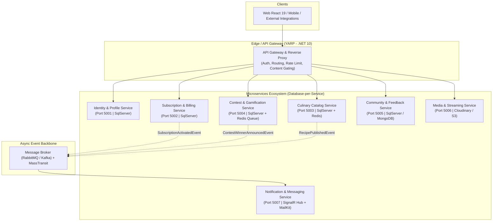
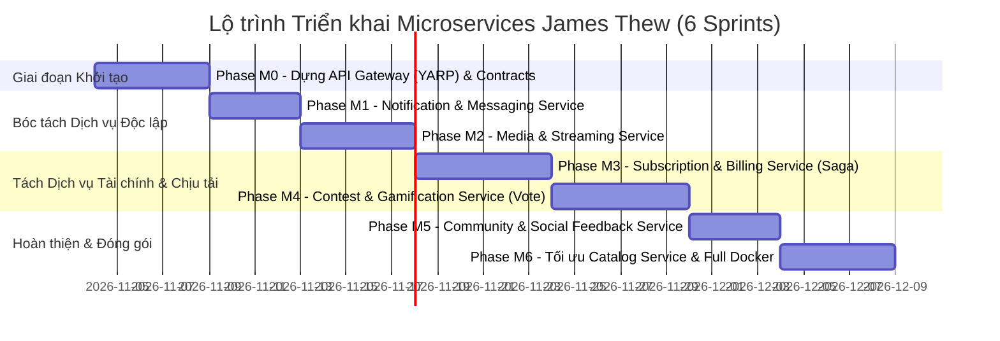

# 🏛️ KẾ HOẠCH TRIỂN KHAI KIẾN TRÚC VI DỊCH VỤ (MICROSERVICES MASTER PLAN)
## Dự án: Nền Tảng Ẩm Thực & Cuộc Thi Nấu Ăn Toàn Cầu — James Thew Culinary Portal
### Căn cứ quy chuẩn: `rules.md` · `srs.md` (Phần 6) · Tiêu chuẩn Aptech eProject Semester 3

> **Vai trò:** Senior Business Analyst & Systems Architect  
> **Phương pháp luận:** Domain-Driven Design (DDD) + Event-Driven Architecture + Strangler Fig Migration Pattern  
> **Mục tiêu cốt lõi:** Chuyển đổi an toàn từ Monolith sang Microservices, bảo đảm tính toàn vẹn 100% của 10 Luật vàng kiến trúc trong `rules.md`, không gây gián đoạn hệ thống hiện tại.

---

## 🧭 I. TỔNG QUAN CHIẾN LƯỢC & MÔ HÌNH KIẾN TRÚC (ARCHITECTURAL PARADIGM)

### 1.1. Chiến lược Chuyển dịch: Strangler Fig Pattern
Thay vì "Big Bang Rewrite" (đập đi xây lại tiềm ẩn rủi ro cao), hệ thống áp dụng mô hình **Strangler Fig Pattern**:
1. Đặt **API Gateway (YARP - .NET 10)** làm lá chắn phía trước hệ thống.
2. Hệ thống Monolith hiện tại tiếp tục phục vụ toàn bộ nghiệp vụ.
3. Từng Bounded Context được bóc tách lần lượt thành Microservice độc lập với Database riêng (`Database-per-Service`).
4. API Gateway định tuyến dần lưu lượng từ Monolith sang Microservice mới cho đến khi Monolith chỉ còn lại vai trò là `Culinary Catalog Service`.



---

## 🧩 II. BẢNG PHÂN RÃ DỊCH VỤ & THIẾT KẾ DATA OWNERSHIP

Tuân thủ nghiêm ngặt **10 Luật Vàng (`rules.md`)**:
- *Luật 1-4:* Controller mỏng, nghiệp vụ đóng gói trong Service, kiểm tra quyền tại API, phụ thuộc 1 chiều.
- *Luật 5-7:* Trả DTO chuyên biệt, danh tính lấy từ JWT Claims/Gateway Header (`X-User-Id`, `X-User-Role`), Server quyết định giá cước và cờ `IsFree`.
- *Luật 8-9:* Giao dịch qua Saga/Transactional Outbox, không lưu thẻ/CVV nhạy cảm.

| Microservice | Bounded Context & Nghiệp vụ Sở hữu | Bảng CSDL Sở hữu Độc quyền | Giao diện API Chính (REST) | Sự kiện Xuất bản (Outbound Events) |
| :--- | :--- | :--- | :--- | :--- |
| **1. Identity & Profile** | Đăng ký, đăng nhập JWT, quản lý thông tin Chef James Thew và Thành viên. | `Users`, `Roles`, `UserPreferences` | `/api/v1/auth/*`<br>`/api/v1/users/*` | `UserRegisteredEvent`<br>`UserProfileUpdatedEvent` |
| **2. Subscription & Billing** | Quản lý gói cước ($10/tháng, $100/năm), xử lý thanh toán mô phỏng/Stripe, lịch sử giao dịch. | `Subscriptions`, `Payments` | `/api/v1/subscriptions/*`<br>`/api/v1/payments/*` | `SubscriptionActivatedEvent`<br>`SubscriptionExpiredEvent` |
| **3. Culinary Catalog** | Danh mục món (Juices, Vegetarian, Non-Vegetarian, Italian), công thức nấu ăn, mẹo bếp, FAQ. Thực thi cờ `IsFree`. | `Categories`, `Recipes`, `RecipeIngredients`, `CookingSteps`, `Tips`, `Faqs` | `/api/v1/recipes/*`<br>`/api/v1/tips/*`<br>`/api/v1/categories/*`<br>`/api/v1/faqs/*` | `RecipePublishedEvent`<br>`TipPublishedEvent` |
| **4. Contest & Gamification** | Cuộc thi nấu ăn/mẹo, tiếp nhận bài thi (Guest/Member), chống spam vote, chấm giải & Announcements. | `Contests`, `ContestEntries`, `ContestVotes`, `Announcements` | `/api/v1/contests/*`<br>`/api/v1/contests/{id}/entries`<br>`/api/v1/contests/entries/{id}/vote` | `ContestCreatedEvent`<br>`ContestWinnerAnnouncedEvent` |
| **5. Community & Feedback** | Đánh giá công thức kèm ảnh/video (`MediaUrl`), xếp hạng 1-5 sao, góp ý website, đếm lượt share FB. | `Feedbacks`, `RecipeComments`, `ShareLogs` | `/api/v1/feedbacks/*`<br>`/api/v1/recipes/{id}/comments` | `CommentAddedEvent`<br>`FeedbackSubmittedEvent` |
| **6. Media & Streaming** | Cấp pre-signed URL upload ảnh/video, phân phối luồng phát Talkshow & Live cooking sessions qua CDN. | `MediaAssets`, `StreamSchedules` | `/api/v1/media/upload-ticket`<br>`/api/v1/streams/live-channels` | `MediaUploadedEvent`<br>`LiveStreamStartedEvent` |
| **7. Notification & Messaging** | Tiếp nhận sự kiện từ Message Bus để gửi Email hóa đơn/chúc mừng và đẩy thông báo thời gian thực lên web. | `NotificationLogs`, `InAppNotifications` | `/api/v1/notifications/*`<br>`/hub/notifications` (SignalR) | `NotificationDeliveredEvent` |

---

## ⚡ III. ĐẶC TẢ GIAO DỊCH PHÂN TÁN (SAGA ORCHESTRATION & CHOREOGRAPHY)

### 3.1. Saga Kích hoạt Hội viên ($10/tháng hoặc $100/năm)
* **Bài toán:** Đảm bảo khi người dùng thanh toán tiền thành công, trạng thái hội viên được nâng cấp ngay lập tức và hóa đơn được gửi qua email mà không xảy ra tình trạng "đã trừ tiền nhưng không lên VIP".
* **Giải pháp:** Áp dụng **Transactional Outbox Pattern** tại Subscription Service kết hợp Message Broker:

```
[Client: Member] 
     │ POST /api/v1/subscriptions/checkout {Plan: MONTHLY, Amount: 10}
     ▼
[Subscription & Billing Service]
     │ 1. Validate số tiền từ Server (bỏ qua giá client gửi theo Luật 7)
     │ 2. Xử lý thanh toán thẻ giả lập
     │ 3. Lưu bản ghi Payment & Subscription (Status = ACTIVE)
     │ 4. Lưu bản ghi OutboxMessage trong cùng 1 Local Transaction (BeginTransactionAsync)
     ▼
[Outbox Publisher Background Worker]
     │ Quét OutboxMessage & bắn sự kiện ra RabbitMQ/Kafka
     ▼
[Message Bus: Topic "subscription.events"]
     ├──► [Identity Service Consumer]
     │         Cập nhật Role = 'MEMBER', gia hạn SubscriptionExpiryDate = Now + 30 ngày.
     │
     └──► [Notification Service Consumer]
               Gửi Email biên lai thu $10 USD & Bắn SignalR pop-up lên trình duyệt.
```

### 3.2. Saga Chấm giải & Công bố Quán quân Cuộc thi
* **Bài toán:** Khi Chef James Thew chọn Quán quân từ hàng trăm bài dự thi (bao gồm cả Guest và Member theo Rule 5), hệ thống phải vinh danh người chiến thắng trên toàn trang web và gửi thư riêng cho người thắng cuộc.
* **Quy trình:**
  1. `Contest Service` cập nhật `IsWinner = true` cho bài thi được chọn.
  2. Tạo bản ghi `Announcement` hiển thị công khai.
  3. Bắn sự kiện `ContestWinnerAnnouncedEvent`.
  4. `Notification Service` đón nhận sự kiện:
     - Gửi email chúc mừng trực tiếp đến `GuestEmail` hoặc `MemberEmail`.
     - Phát sóng thông báo In-App qua SignalR Hub tới tất cả người dùng đang lướt web.

---

## 🛡️ IV. CƠ CHẾ CONTENT GATEKEEPING TẠI CỔNG BIÊN (API GATEWAY)

Theo **Rule 3 (`rules.md`)**:
- `Guest`: Chỉ được xem và tìm kiếm Recipes/Tips có `IsFree == true`.
- `Member`: Được xem 100% nội dung bài viết và video độc quyền.
- `Admin (James Thew)`: Toàn quyền quản trị và phân loại nội dung.

### Thiết kế luồng xử lý tại YARP Gateway & Culinary Catalog Service:
1. **Tại API Gateway:**
   - Đọc header `Authorization: Bearer <token>`.
   - Nếu token hợp lệ: Trích xuất `UserId`, `Role` (`ADMIN` hoặc `MEMBER`), `SubscriptionActive`.
   - Nếu không có token: Gán mặc định `X-User-Role = GUEST`.
   - Forward các header này xuống `Culinary Catalog Service`.
2. **Tại Culinary Catalog Service:**
   - Đối với Request công khai:
     ```csharp
     /// <summary>
     /// Tự động áp dụng Content Gatekeeping theo Rule 3 của rules.md
     /// </summary>
     if (userRole == "GUEST" || !isSubscriptionActive)
     {
         query = query.Where(r => r.IsFree == true);
     }
     ```
   - Đối với Endpoint xem chi tiết bài Member-only (`GET /api/v1/recipes/{id}`):
     - Nếu bài viết có `IsFree == false` và `userRole == "GUEST"`: Lập tức trả về mã lỗi `HTTP 403 Forbidden` kèm payload `{ message: "Nội dung độc quyền dành cho Thành viên VIP của Chef James Thew. Vui lòng nâng cấp gói $10/tháng để tiếp tục." }`.

---

## 🚀 V. LỘ TRÌNH CHUYỂN ĐỔI CHI TIẾT (6 GIAI ĐOẠN - PHASES)



### Chi tiết từng Phase:

#### Phase M0: Hạ tầng API Gateway & Thư viện DTO Dùng chung (Foundation)
* **Mục tiêu:** Dựng YARP Gateway phía trước Monolith, xây dựng project `JamesThew.Shared.Contracts` chứa toàn bộ DTOs và Event Models.
* **Sản phẩm:**
  - Reverse proxy định tuyến trong suốt tới Monolith hiện tại (`http://localhost:5000`).
  - Frontend React 19 chuyển hướng gọi API qua Gateway (`http://localhost:8000`).
  - Kiểm thử: 100% 157 bài test hiện có chạy thông qua Gateway không lỗi.

#### Phase M1: Bóc tách Notification & Messaging Service
* **Mục tiêu:** Tách toàn bộ tính năng gửi Email (MailKit) và Real-time Notification (SignalR) ra khỏi Monolith.
* **Sản phẩm:**
  - Microservice `NotificationService` (.NET 10 Web API + SignalR Hub).
  - Tích hợp Message Broker (RabbitMQ hoặc in-memory broker cho môi trường Test).
  - Monolith publish event; Notification Service tiêu thụ và gửi mail/push chuông.

#### Phase M2: Bóc tách Media & Streaming Service
* **Mục tiêu:** Giải phóng tải upload ảnh món ăn, video hướng dẫn và chuẩn bị cơ sở hạ tầng phát sóng Talkshow/Live show.
* **Sản phẩm:**
  - Microservice `MediaService` tích hợp Cloudinary/AWS S3 qua Pre-signed URL.
  - API Gateway định tuyến `/api/v1/media/*` sang Media Service.

#### Phase M3: Bóc tách Subscription & Billing Service
* **Mục tiêu:** Cách ly dữ liệu thanh toán, tuân thủ PCI-DSS, thực thi đăng ký kèm thanh toán nguyên tử qua Saga Pattern.
* **Sản phẩm:**
  - Database riêng cho `Subscriptions` và `Payments`.
  - Triển khai Transactional Outbox Pattern xử lý sự kiện `SubscriptionActivatedEvent`.
  - Đồng bộ trạng thái hội viên sang `Identity Service`.

#### Phase M4: Bóc tách Contest & Gamification Service
* **Mục tiêu:** Tách phân hệ cuộc thi nấu ăn và bình chọn cộng đồng để sẵn sàng cho lưu lượng đột biến.
* **Sản phẩm:**
  - Microservice `ContestService` với Redis In-Memory Counter cho tính năng Vote.
  - Cho phép Guest nộp bài thi lưu `GuestName` và `GuestEmail` theo Rule 5.
  - Luồng Admin chấm giải và tự động bắn sự kiện công bố quán quân.

#### Phase M5: Bóc tách Community & Feedback Service
* **Mục tiêu:** Tách chức năng bình luận món ăn (kèm ảnh/video thành phẩm), đánh giá sao và chia sẻ Facebook.
* **Sản phẩm:**
  - Microservice `CommunityService` lưu trữ và truy vấn phản hồi của độc giả.
  - Phục vụ API `/api/v1/feedbacks` độc lập với core recipe database.

#### Phase M6: Hoàn thiện Culinary Catalog Service & Đóng gói Docker Compose
* **Mục tiêu:** Phần lõi Monolith trở thành `Culinary Catalog Service` chuyên biệt, bổ sung Redis Cache cho các bài `IsFree == true`.
* **Sản phẩm:**
  - Bộ file `docker-compose.yml` triển khai toàn bộ hệ thống gồm 7 Microservices, API Gateway, SQL Server, Redis, RabbitMQ.
  - Tài liệu bàn giao đầy đủ 13 mục theo yêu cầu Aptech eProject.

---

## 👥 VI. BẢNG PHÂN CHIA NHIỆM VỤ 4 THÀNH VIÊN (TASK SHEET NHÓM)

Theo đúng quy chuẩn phân công công việc của đồ án Aptech eProject Semester 3:

| Thành viên | Phân hệ Microservice phụ trách | Nhiệm vụ Kỹ thuật (.NET 10 & React 19) | Tài liệu Báo cáo Phụ trách |
| :--- | :--- | :--- | :--- |
| **Thành viên 1** *(Lead)* | **API Gateway (YARP), Identity Service & Subscription Service** | • Cấu hình Gateway định tuyến, JWT Auth, Content Gatekeeping.<br>• Xây dựng `IdentityService` & `SubscriptionService`.<br>• Triển khai Outbox Pattern & Saga thanh toán $10/$100. | • Problem Definition & SRS Microservices.<br>• Project Plan & Task Sheet.<br>• Soạn 2 Email trạng thái `STATUS:`. |
| **Thành viên 2** | **Culinary Catalog Service & Media Service** | • Xây dựng `CatalogService` (Recipes, Tips, Categories, FAQs).<br>• Tích hợp Redis Caching tối ưu đọc $P_{99} < 100\text{ ms}$.<br>• Xây dựng `MediaService` cấp Pre-signed URL upload ảnh/video. | • Sơ đồ Kiến trúc & ERD các Service.<br>• Thuật toán lọc nội dung Free/Paid & Saga Flowcharts. |
| **Thành viên 3** | **Contest & Gamification Service & Message Bus Backbone** | • Dựng cụm Message Broker (RabbitMQ / MassTransit).<br>• Xây dựng `ContestService` & cơ chế Vote chống spam.<br>• Xử lý sự kiện công bố quán quân và Announcements. | • Tài liệu Chuẩn giao diện (GUI Standards).<br>• Thiết kế giao diện tương tác Cuộc thi & Bình chọn. |
| **Thành viên 4** | **Community Service, Notification Service & Docker DevOps** | • Xây dựng `NotificationService` (MailKit + SignalR Hub).<br>• Xây dựng `CommunityService` (Comments, Media Reviews, FB Share).<br>• Đóng gói Docker Compose & viết Unit/Integration Tests. | • Báo cáo Review & Monitoring Report.<br>• Checklist Unit Test & Final Checklist bàn giao. |

---

## 📊 VII. MA TRẬN QUẢN TRỊ RỦI RO (RISK MANAGEMENT MATRIX)

| Rủi ro Kỹ thuật & Nghiệp vụ | Khả năng | Tác động | Biện pháp Phòng ngừa & Xử lý (Senior BA Strategy) |
| :--- | :---: | :---: | :--- |
| **1. Sai lệch dữ liệu giữa Subscription và Identity (Data Inconsistency)** | Thấp | Nghiêm trọng | Sử dụng **Transactional Outbox Pattern** tại Subscription Service. Nếu Identity Service chưa nhận được tin, tin nhắn vẫn nằm an toàn trong Queue và được Retry tự động (Dead-Letter Queue). |
| **2. Nghẽn mạng & gọi chéo quá nhiều (Chatty Services / Latency)** | Trung bình | Đáng kể | Thiết kế DTO phẳng; API Gateway đóng vai trò Aggregator (BFF) gom dữ liệu của nhiều service trả về trong 1 HTTP Request duy nhất cho trang chủ React. |
| **3. Gian lận lượt bình chọn Cuộc thi (Voting Concurrency Spike)** | Trung bình | Trung bình | Lưu lượt vote tạm thời vào **Redis In-Memory Set** với khóa `{contestId}:{entryId}:{userId_or_ip}` để chống trùng lặp, sau đó Worker đồng bộ định kỳ theo lô xuống SQL Server. |
| **4. Phòng ngừa 3 rủi ro mất mát từ SRS (Virus, Lỗi hệ thống, Hỏng file)** | Thấp | Nghiêm trọng | Sao lưu định kỳ toàn bộ kho mã nguồn Git và export script SQL Server hàng ngày theo đúng quy định tại Mục 5 của `rules.md`. |

---

## ✅ VIII. TIÊU CHÍ NGHIỆM THU (ACCEPTANCE CRITERIA)
1. **Toàn vẹn Nghiệp vụ (100% Business Rule Compliance):**
   - Khách vãng lai chỉ thấy bài Free; Thành viên trả phí xem được toàn bộ bài viết và video.
   - Nộp bài thi cuộc thi hỗ trợ cả Guest (lưu Name, Email) và Member.
   - Đăng ký thành viên bắt buộc kèm thanh toán $10/tháng hoặc $100/năm.
   - Hiển thị chính xác 7 câu hỏi FAQ cố định theo đề bài Aptech.
2. **Kiểm thử Tự động (Testing Suite):**
   - Duy trì 100% tỷ lệ vượt qua của toàn bộ Unit & Integration Tests.
   - Bổ sung Contract Tests cho các API Endpoints giữa Gateway và Microservices.
3. **Đạt chuẩn Bàn giao Đồ án Aptech:**
   - Đầy đủ 13 đề mục hồ sơ báo cáo, 2 template Email tiến độ (`STATUS:`) và 1 Feedback Form hoàn chỉnh.

