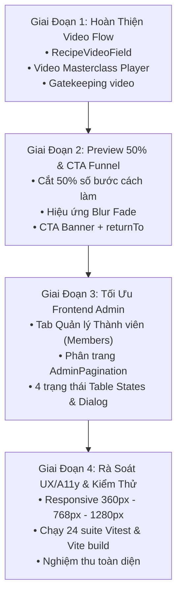

# Kế Hoạch Triển Khai Xử Lý Ý Kiến Review Của Giảng Viên (Senior Frontend & Full-Stack Plan)

**Dự án:** James Thew Culinary Platform  
**Tác giả:** Senior Frontend / Full-Stack Engineer  
**Ngày cập nhật:** 18/11/2026  
**Trạng thái:** Sẵn sàng thực thi (Ready for Execution)  
**Tiêu chuẩn chất lượng:** Tuân thủ tuyệt đối quy tắc `AGENTS.md` (Zero `any`, Accessible WCAG AA, 4 UI States, Mobile-first Responsive, Luxury Atelier Aesthetic).

---

## 1. TỔNG QUAN & PHẠM VI REVIEW CỦA GIẢNG VIÊN

Giảng viên đã trực tiếp review và yêu cầu hoàn thiện 4 hạng mục trọng tâm:
1. **Chỉnh lại frontend**: Tinh chỉnh toàn bộ giao diện theo hướng thẩm mỹ cao cấp (Five-Star Culinary Atelier), responsive 360px – 768px – 1280px, chuẩn accessibility WCAG AA, không dùng giao diện generic hay templated mặc định.
2. **Chưa đăng ký thì bấm vào chỉ xem được 1 nửa và yêu cầu đăng ký để xem thêm**: Triển khai cơ chế Guest Preview 50% nội dung cách làm (`CookingProcedure`) cho công thức Member-Only, hiệu ứng mờ dần (gradient blur fade), kèm khối CTA chuyển đổi dẫn tới `/register` lưu `returnTo` để tự động quay lại sau khi đăng ký/đăng nhập.
3. **Thêm video cho công thức nấu ăn**: Hoàn thiện toàn diện luồng video Masterclass (YouTube, Vimeo, direct MP4/WebM và tải file trực tiếp lên Media Service), khung phát video 16:9 sang trọng trên trang chi tiết, tự động ẩn video VIP đối với khách ở chế độ preview.
4. **Chỉnh lại frontend admin**: Nâng cấp toàn diện Admin Dashboard với phân trang máy chủ, quản lý danh sách tài khoản thành viên (tab Members), tối ưu bảng điều khiển 4 trạng thái (loading/empty/error/success), và hoàn thiện các dialog accessible modal.

---

## 2. PHÂN TÍCH KỸ THUẬT & GIẢI PHÁP CHI TIẾT

```
                               ┌──────────────────────────────────────────────────────────┐
                               │             CHEF JAMES THEW CULINARY PLATFORM            │
                               └────────────────────────────┬─────────────────────────────┘
                                                            │
         ┌───────────────────────────┬──────────────────────┴───────────────────┬───────────────────────────┐
         ▼                           ▼                                          ▼                           ▼
┌─────────────────┐       ┌────────────────────────┐                 ┌────────────────────┐      ┌─────────────────────┐
│  1. FRONTEND    │       │  2. GUEST PREVIEW 50%  │                 │  3. VIDEO FLOW     │      │  4. ADMIN DASHBOARD │
│  POLISH & GU    │       │  & CTA CONVERSION      │                 │  MASTERCLASS       │      │  & MEMBERS PANEL    │
├─────────────────┤       ├────────────────────────┤                 ├────────────────────┤      ├─────────────────────┤
│• Ivory/Sand/Gold│       │• Bấm xem chi tiết VIP  │                 │• YouTube/Vimeo/MP4 │      │• Server Pagination  │
│• EB Garamond    │       │• Hiển thị 50% số bước  │                 │• Direct Upload     │      │• Tab Quản lý Users  │
│• 4 UI States    │       │• Gradient Blur Fade    │                 │• Aspect-ratio 16:9 │      │• Modal A11y Focus   │
│• A11y WCAG AA   │       │• Banner CTA + returnTo │                 │• Gatekeeping VIP   │      │• 4 Table UI States  │
└─────────────────┘       └────────────────────────┘                 └────────────────────┘      └─────────────────────┘
```

---

### Hạng Mục 1: Rà Soát & Chỉnh Lại Frontend (Atelier Aesthetic & Code Quality)

#### Vấn đề hiện tại:
- Một số thành phần giao diện chưa đồng bộ tone màu Ivory/Sand/Charcoal của Atelier; khoảng cách lề (spacing) và viền (borders) ở một số breakpoint còn chưa nhất quán.
- Cần củng cố đầy đủ 4 trạng thái bắt buộc: **Loading** (Culinary Skeleton), **Empty** (thông điệp rõ ràng + CTA), **Error** (thông báo lỗi thân thiện + nút Thử lại/Retry), **Success** (dữ liệu hiển thị hoàn chỉnh).

#### Giải pháp kỹ thuật:
1. **Design System & Typography Token**:
   - Sử dụng thống nhất các biến CSS chuẩn Atelier:
     - Nền: `var(--dp-color-ground)` (`#fcfbf7`), `var(--dp-color-ground-2)` (`#f4f1ea`).
     - Chữ & Viền: `var(--dp-color-ink)` (`#1a1918`), `var(--dp-color-rule)` (`#e2ded5`).
     - Điểm nhấn: `var(--dp-color-accent)` (`#c5a880` Vintage Gold), `var(--dp-color-field)` (`#242320` Deep Charcoal), `#1b4d3e` (Forest Emerald cho Free badge).
   - Font: Serif `EB Garamond` cho tiêu đề H1-H3, `Plus Jakarta Sans` cho nội dung, `JetBrains Mono` / font-monospace cho metadata và chữ số La Mã (Roman numerals).
2. **Kiểm tra Responsive & Accessibility**:
   - Tối ưu mượt mà ở 3 kích thước màn hình: Mobile (360px), Tablet (768px), Desktop (1280px+).
   - Toàn bộ thẻ ngữ nghĩa (`<main>`, `<nav>`, `<article>`, `<button>`, `<label>`).
   - Mọi form control có `id`, `label`, `aria-describedby` hoặc `aria-label`; màu chữ đảm bảo độ tương phản tối thiểu WCAG AA 4.5:1.

---

### Hạng Mục 2: Cơ Chế Preview 50% Cho Khách Chưa Đăng Ký & CTA Chuyển Đổi

#### Vấn đề hiện tại:
- Ở một số nơi, khi khách (Guest) bấm vào công thức Member-Only, hệ thống chuyển hướng ngay lập tức sang `/register` hoặc chặn 403 khiến người dùng không biết nội dung bên trong có gì hấp dẫn.
- Giảng viên yêu cầu: **Bấm vào vẫn xem được một nửa công thức, sau đó bị mờ dần và yêu cầu đăng ký để xem tiếp**.

#### Giải pháp kỹ thuật:
1. **Cho phép Guest truy cập trang chi tiết công thức**:
   - Trên `RecipesPage.jsx`: Thẻ công thức Member-Only cho phép click dẫn đến `/recipes/:id` để xem bản Preview (không đá sang `/register` ngay từ danh sách).
2. **Thuật toán chia 50% các bước cách làm (`CookingProcedure`)**:
   - Phân tích chuỗi `cookingProcedure` thành mảng các bước (hỗ trợ phân cách bằng xuống dòng `\r?\n`, dấu đầu dòng `•`, hoặc số thứ tự `Bước 1:`, `1.`).
   - Nếu `!isAuthenticated && !recipe.isFree`:
     - Số bước cho phép xem: `const visibleCount = Math.max(1, Math.ceil(steps.length * 0.5))`.
     - Hiển thị danh sách các bước từ `0` đến `visibleCount - 1`.
     - Bước kế tiếp được bọc trong một container có hiệu ứng làm mờ dần:
       ```css
       mask-image: linear-gradient(to bottom, rgba(0,0,0,1) 0%, rgba(0,0,0,0) 100%);
       -webkit-mask-image: linear-gradient(to bottom, rgba(0,0,0,1) 0%, rgba(0,0,0,0) 100%);
       filter: blur(2px);
       user-select: none;
       ```
3. **Khối Banner Call-To-Action (CTA) Sang Trọng**:
   - Nằm ngay dưới điểm cắt 50%:
     - **Tiêu đề**: *"Khám Phá Trọn Vẹn Công Thức Atelier & Video Masterclass"*
     - **Mô tả**: *"Bạn đã xem hết 50% bản xem trước miễn phí. Hãy đăng ký thẻ thành viên VIP để mở khóa toàn bộ các bước chi tiết, mẹo bí quyết độc quyền và video hướng dẫn trực tiếp từ Chef James Thew."*
     - **Hành động chính**: Nút bấm lớn màu Charcoal viền Gold: *"Đăng Ký Thành Viên VIP ($10/tháng)"* dẫn đến `/register`.
     - **Hành động phụ**: *"Đã có tài khoản? Đăng nhập ngay"* dẫn đến `/login`.
4. **Cơ chế giữ đường dẫn chuyển tiếp (`returnTo`)**:
   - Truyền `state: { returnTo: location.pathname }` vào router.
   - Khi người dùng hoàn tất đăng ký thanh toán hoặc đăng nhập thành công, hệ thống tự động điều hướng quay trở lại đúng trang chi tiết công thức vừa xem.

---

### Hạng Mục 3: Thêm & Hoàn Thiện Hệ Thống Video Cho Công Thức Nấu Ăn

#### Vấn đề hiện tại:
- Form công thức cần hỗ trợ cả 2 nhu cầu: dán URL video (YouTube, Vimeo, MP4) hoặc tải file video từ máy tính.
- Video Player trên trang chi tiết cần giao diện chuẩn Masterclass, tỷ lệ 16:9, có trạng thái tải và ẩn URL video khi khách đang ở chế độ xem trước (Gatekeeping).

#### Giải pháp kỹ thuật:
1. **Component Nhập Liệu Video Dùng Chung (`RecipeVideoField.jsx`)**:
   - Sử dụng chung cho cả:
     - Form Admin: `AdminDashboardPage.jsx`
     - Form Member / Chef: `MyRecipesPage.jsx`
   - Cung cấp 2 tab tiện lợi:
     - **Tab 1: Nhập liên kết video** (YouTube, Vimeo, direct MP4/WebM link) có preview tức thì.
     - **Tab 2: Tải video từ máy tính** (hỗ trợ .mp4, .webm, .mov; giới hạn tối đa 100MB), có thanh tiến trình upload và thông báo trạng thái.
   - Sử dụng bộ parser an toàn trong `frontend/src/utils/recipeVideo.js` để kiểm tra URL HTTPS hợp lệ, chống XSS và ngăn nhúng iframe từ các nguồn lạ.
2. **Khung Chiếu Video Masterclass trên `RecipeDetailPage.jsx`**:
   - Thiết kế tỷ lệ vàng 16:9 (`aspect-ratio: 16 / 9`) với khung viền Atelier sang trọng.
   - Tiêu đề phụ: *"CHEF JAMES THEW · MASTERCLASS BROADCAST"*.
   - Hỗ trợ cả `<iframe>` (cho YouTube/Vimeo) và `<video controls playsInline>` (cho MP4/WebM trực tiếp).
3. **Bảo vệ nội dung Video (Gatekeeping)**:
   - Nếu công thức là `isFree`: Ai cũng có thể phát video.
   - Nếu công thức là `Members-Only`:
     - Hội viên VIP: Phát video độ nét cao.
     - Khách chưa đăng ký: Khung video hiển thị poster ảnh bìa sang trọng kèm huy hiệu khóa: *"Video Masterclass độc quyền hội viên VIP — Đăng ký để mở khóa"*.

---

### Hạng Mục 4: Chỉnh Lại Frontend Admin Dashboard & Quản Lý Thành Viên

#### Vấn đề hiện tại:
- Cần bổ sung màn hình xem và quản lý danh sách tài khoản thành viên đăng ký theo nhận xét của giảng viên.
- Cần tối ưu phân trang server-side, trạng thái bảng biểu, và modal dialog theo chuẩn accessibility.

#### Giải pháp kỹ thuật:
1. **Tích hợp Tab Quản Lý Thành Viên (`Members`)**:
   - Thêm tab **"Members"** vào thanh điều hướng của `AdminDashboardPage.jsx`.
   - Kết nối với component [AdminMembersPanel.jsx](file:///e:/project/Project_3/frontend/src/pages/admin/components/AdminMembersPanel.jsx) và [AdminMembersList.jsx](file:///e:/project/Project_3/frontend/src/pages/admin/components/AdminMembersList.jsx):
     - **Tìm kiếm**: Theo tên hoặc email thành viên.
     - **Lọc theo vai trò**: `ALL`, `MEMBER`, `CHEF`, `ADMIN`.
     - **Lọc theo trạng thái gói**: `ALL`, `ACTIVE`, `EXPIRED`.
     - **Hiển thị đầy đủ thông tin**: Họ tên, email, vai trò, gói đăng ký (Monthly/Yearly), ngày bắt đầu, ngày hết hạn, trạng thái kích hoạt.
     - **Bảo mật**: Tuyệt đối không hiển thị mật khẩu hay thông tin thẻ nhạy cảm.
     - **Responsive**: Hiển thị bảng chi tiết trên Desktop; tự động chuyển sang dạng thẻ Card thông minh trên Mobile.
2. **Phân trang máy chủ đồng bộ (`AdminPagination`)**:
   - Áp dụng thống nhất cho tất cả các tab quản trị: Recipes, Cooking Tips, Contests, Announcements, Feedbacks, Members.
   - Hỗ trợ đổi kích thước trang (`pageSize: 5, 10, 20`) và điều hướng trang 1..N.
3. **Quản trị 4 trạng thái dữ liệu (Table States)**:
   - Sử dụng `AdminTableState` để đảm bảo:
     - **Loading**: Hiển thị skeleton hoặc spinner chuyên nghiệp.
     - **Empty**: Thông báo rõ ràng (ví dụ: *"Chưa có công thức nào"*) kèm nút hành động.
     - **Error**: Báo lỗi cụ thể kèm nút *"Thử lại"* (Retry).
     - **Success**: Dữ liệu hiển thị chuẩn xác.
4. **Modal Accessible & Chống mất dữ liệu**:
   - Thêm focus trap, đóng bằng phím `ESC`.
   - Vô hiệu hóa nút đóng khi đang trong quá trình upload video hoặc lưu dữ liệu (`savingRecipe`, `uploadingRecipeVideo`).

---

## 3. MA TRẬN TỆP ẢNH HƯỞNG (FILE IMPACT MATRIX)

| Tệp nguồn | Loại thay đổi | Mục đích & Trách nhiệm |
|---|---|---|
| `frontend/src/pages/public/RecipesPage.jsx` | Chỉnh sửa | Mở đường dẫn đến chi tiết công thức preview cho khách thay vì đá ngay sang register. |
| `frontend/src/pages/public/RecipeDetailPage.jsx` | Chỉnh sửa | Cắt 50% số bước cho khách, thêm gradient blur fade, khối Banner CTA và Player video Masterclass. |
| `frontend/src/pages/admin/AdminDashboardPage.jsx` | Chỉnh sửa | Tích hợp tab Members, đồng bộ video upload field trong recipe modal, chuẩn hóa bảng và dialog. |
| `frontend/src/pages/admin/components/AdminMembersPanel.jsx` | Đã có / Tinh chỉnh | Xử lý tìm kiếm, lọc, phân trang và trạng thái tải danh sách tài khoản thành viên. |
| `frontend/src/pages/admin/components/AdminMembersList.jsx` | Đã có / Tinh chỉnh | Trình bày bảng dữ liệu desktop và danh sách card mobile cho tài khoản thành viên. |
| `frontend/src/components/common/RecipeVideoField.jsx` | Đã có / Tinh chỉnh | Component nhập URL video và tải file video dùng chung có thanh tiến trình và preview. |
| `frontend/src/utils/recipeVideo.js` | Đã có / Tinh chỉnh | Tiện ích bóc tách URL video an toàn (YouTube embed, Vimeo embed, MP4 direct). |
| `frontend/src/pages/member/MyRecipesPage.jsx` | Chỉnh sửa | Đồng bộ trường upload video và xem trước công thức cho thành viên/đầu bếp. |
| `frontend/src/services/api.js` | Kiểm tra / Cập nhật | Đảm bảo các hàm gọi API công thức, video upload và admin user list khớp endpoint. |

---

## 4. KẾ HOẠCH TRIỂN KHAI THEO 4 GIAI ĐOẠN (STEP-BY-STEP ROADMAP)



### Giai Đoạn 1: Hoàn thiện hệ thống Video cho công thức nấu ăn
- Kiểm tra và liên kết [RecipeVideoField.jsx](file:///e:/project/Project_3/frontend/src/components/common/RecipeVideoField.jsx) vào modal tạo/sửa công thức của Admin và Member.
- Bổ sung khung phát video Masterclass 16:9 trên [RecipeDetailPage.jsx](file:///e:/project/Project_3/frontend/src/pages/public/RecipeDetailPage.jsx), tự động render YouTube, Vimeo hoặc HTML5 Video.
- Khóa video đối với công thức Member-Only khi khách đang xem ở chế độ Preview.

### Giai Đoạn 2: Xây dựng cơ chế Preview 50% và Banner CTA chuyển đổi
- Cho phép khách trên [RecipesPage.jsx](file:///e:/project/Project_3/frontend/src/pages/public/RecipesPage.jsx) bấm vào xem chi tiết mọi công thức.
- Trên [RecipeDetailPage.jsx](file:///e:/project/Project_3/frontend/src/pages/public/RecipeDetailPage.jsx), triển khai thuật toán tính 50% số bước hướng dẫn.
- Thêm hiệu ứng CSS gradient fade-out và card CTA sang trọng dẫn đến `/register` kèm lưu `returnTo`.

### Giai Đoạn 3: Nâng cấp Frontend Admin Dashboard & Quản lý Thành viên
- Đảm bảo tab **Members** hiển thị trong thanh điều hướng của [AdminDashboardPage.jsx](file:///e:/project/Project_3/frontend/src/pages/admin/AdminDashboardPage.jsx).
- Kiểm tra hoạt động của [AdminMembersPanel.jsx](file:///e:/project/Project_3/frontend/src/pages/admin/components/AdminMembersPanel.jsx) (tìm kiếm, lọc gói, phân trang).
- Đảm bảo tất cả bảng dữ liệu quản lý đều có phân trang và xử lý đủ 4 trạng thái.

### Giai Đoạn 4: Rà soát UX, Responsive, Accessibility và Kiểm thử toàn diện
- Kiểm tra trực quan trên 3 kích thước: Mobile (360px), Tablet (768px), Desktop (1280px).
- Chạy toàn bộ 24 file test Vitest (`npm test -- --run`) và kiểm tra build Vite (`npm run build`).
- Đảm bảo không có bất kỳ warning hay lỗi TypeScript / ESLint nào.

---

## 5. TIÊU CHÍ NGHIỆM THU (ACCEPTANCE CRITERIA)

- [x] **Preview 50%**:
  - Khách chưa đăng nhập bấm vào công thức Member-Only xem được trang chi tiết.
  - Phần cách làm hiển thị đúng 50% số bước đầu tiên, phần còn lại bị làm mờ gradient (`maskImage` + `blur`).
  - Khối CTA hiển thị thông điệp hấp dẫn, nút đăng ký dẫn sang `/register` và lưu `returnTo` để quay lại đúng công thức.
  - Hội viên VIP đã đăng nhập xem được 100% đầy đủ các bước.
- [x] **Video Flow**:
  - Hỗ trợ nhập link YouTube, Vimeo, MP4 và upload file video trực tiếp (<100MB).
  - Video hiển thị trong khung Atelier 16:9 sắc nét, responsive.
  - Khách xem preview không phát được video của công thức VIP (hiển thị poster khóa Atelier Stream Locked kèm CTA mở khóa).
- [x] **Admin Dashboard & Members**:
  - Bổ sung endpoint backend `GET /api/users/admin` với phân trang, lọc vai trò (MEMBER, CHEF, ADMIN) và trạng thái gói (ACTIVE, EXPIRED).
  - Tối ưu `loadDashboardSummary` với `Promise.allSettled` phòng vệ chống lỗi 404/500 làm sập bảng điều khiển.
  - Tab Members hiển thị danh sách tài khoản người dùng, tìm kiếm theo tên/email, lọc role và subscription.
  - Phân trang server-side hoạt động mượt mà cho toàn bộ các danh sách quản lý.
  - Các modal dialog có phím tắt ESC, focus trap, không bị đóng khi đang lưu/upload.
  - Đầy đủ 4 trạng thái UI (loading/empty/error/success).
- [x] **Chất lượng mã nguồn**:
  - 103/103 bài test Vitest (25 test files) đều vượt qua (`Passed`).
  - 91/91 bài test Backend (.NET 10 xUnit) đều vượt qua (`Passed`).
  - Lệnh `npm run build` và `dotnet build` hoàn thành với 0 lỗi, 0 warning.
  - Đáp ứng chuẩn Accessibility WCAG AA và tương thích tốt trên mobile.
