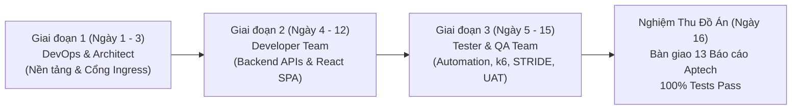

# 🎯 MA TRẬN ĐIỀU PHỐI & PHÂN CÔNG CÔNG VIỆC TỔNG THỂ (TASK COORDINATION SUITE)
## Dự án: Nền Tảng Ẩm Thực & Đấu Trường Nấu Ăn James Thew (James Thew Culinary Portal)
### Tiêu chuẩn Quản trị Dự án: Senior BA Delivery Framework · Aptech eProject Semester 3

> **Chuyên viên Phân tích Nghiệp vụ (Senior Business Analyst):** Lead Systems & Requirements Architect  
> **Căn cứ hệ thống:** [`topic.md`](../../topic.md) · [`srs.md`](../../srs.md) · [`rules.md`](../../rules.md) · [`srsdetails/files/`](../../srsdetails/files/README.md)  
> **Nguyên tắc điều phối:** Thực thi theo trình tự phụ thuộc chuẩn kỹ thuật phần mềm: **Hạ tầng (DevOps/Architect) $\rightarrow$ Lập trình (Developer) $\rightarrow$ Kiểm thử & Nghiệm thu (Tester/QA)**.

---

## 🧭 I. BẢNG PHÂN VAI & THỨ TỰ THỰC THI (WORKFLOW SEQUENCE)

Để tối ưu hóa năng suất và không xảy ra tình trạng "chờ đợi lẫn nhau" (blocking dependencies), quy trình phát triển được phân chia thành 3 giai đoạn kế tiếp và song song:

| Thứ Tự | Nhóm Thực Hiện | Tài Liệu Giao Việc Chi Tiết | Trọng Tâm Nhiệm Vụ | Sản Phẩm Bàn Giao (Outputs) |
| :---: | :--- | :--- | :--- | :--- |
| **1** | **DevOps & Architect** | [`01-devops-architect-tasks.md`](./01-devops-architect-tasks.md) | Dựng hạ tầng Docker Compose, YARP API Gateway (Port 8000), Thư viện DTOs `JamesThew.Shared.Contracts`, Message Broker RabbitMQ, Named Volumes CSDL. | File `docker-compose.yml`, Dockerfile tối ưu Alpine, Gateway reverse proxy định tuyến trong suốt. |
| **2** | **Developer Team (BE & FE)** | [`02-developer-tasks.md`](./02-developer-tasks.md) | Hiện thực hóa 9 modules chức năng (`FR-AUTH` đến `FR-FAQ`), 11 Business Rules (`BR-01..11`), giao diện React 19 Luxury 5 sao, RBAC 3 roles, Content Gatekeeping phía Server. | Source code backend .NET 10, source code frontend React 19, XML comments đầy đủ trên mọi hàm. |
| **3** | **Tester & QA Team** | [`03-tester-qa-tasks.md`](./03-tester-qa-tasks.md) | Kiểm thử hồi quy tự động (duy trì 157/157 tests pass), kiểm thử hiệu năng k6 ($P_{95} \le 500\text{ ms}$), kiểm thử bảo mật STRIDE/PCI-DSS, nghiệm thu 13 hồ sơ đồ án. | Báo cáo kiểm thử 100% Pass, biên bản rà soát bảo mật không có lỗ hổng Critical, 13 đề mục hồ sơ báo cáo. |

---

## 🛡️ II. QUY CHUẨN ĐỊNH NGHĨA HOÀN THÀNH (DEFINITION OF DONE - DoD)

Một Task chỉ được coi là **HOÀN THÀNH (DONE)** khi và chỉ khi thỏa mãn đầy đủ các điều kiện sau:

1. **Tuân thủ 10 Luật Vàng Kiến Trúc ([`rules.md`](../../rules.md)):**
   - Controller mỏng, nghiệp vụ nằm trọn vẹn trong Service.
   - 100% API trả về DTOs, tuyệt đối không trả Entity trực tiếp.
   - Danh tính lấy từ JWT Token Claims / Header Gateway, không lấy từ Request Body hay Query String.
   - Thao tác ghi nhiều bước bắt buộc nằm trong Database Transaction hoặc Saga.
   - Không lưu số thẻ đầy đủ hay mã CVV (chuẩn PCI-DSS).
2. **Tiêu chuẩn Tài liệu & Comment Code:**
   - 100% Class, Controller, Service và Action Method có thẻ **XML Documentation (`/// 
`)**.
3. **Tiêu chuẩn Kiểm thử Tự động:**
   - Không làm gãy bất kỳ ca kiểm thử nào trong bộ kiểm thử hồi quy hiện có (**157 / 157 tests bắt buộc PASS**).
   - Viết bổ sung Unit/Integration tests cho các chức năng mới tạo.
4. **Tiêu chuẩn Containerization:**
   - Dịch vụ phải build và chạy thành công bên trong Docker Container bằng lệnh `docker compose up --build`.

---

## 🤝 III. QUY TRÌNH BÀN GIAO LIÊN NHÓM (HAND-OFF PROTOCOL)

* **DevOps $\rightarrow$ Developer Hand-off:**
  - DevOps bàn giao môi trường Docker Compose và dự án Gateway mẫu. Developer clone repo, chạy `docker compose up` và xác nhận tất cả containers chuyển sang trạng thái `healthy`.
* **Developer $\rightarrow$ QA Hand-off:**
  - Developer hoàn thành module chức năng, tạo Pull Request kèm báo cáo test nội bộ (`dotnet test` và `npm test` đều xanh).
  - QA kéo mã nguồn mới nhất, thực thi bộ kiểm thử tự động, kiểm thử chấp nhận người dùng (UAT) theo `srsdetails/files/06-test-case-checklist.md`.
* **QA $\rightarrow$ Senior BA Hand-off:**
  - QA bàn giao Bảng tổng kết nghiệm thu (Testing Checklist) đạt 100% Pass Rate.
  - Senior BA kiểm tra tính đồng bộ lần cuối với tài liệu đề tài gốc [`docs/dềbài.md`](../../docs/dềbài.md) và ký duyệt hồ sơ bàn giao đồ án Aptech.

---

## 📬 IV. KỶ LUẬT BÁO CÁO TIẾN ĐỘ & SAO LƯU (APTECH COMPLIANCE)

Theo đúng quy định tại Mục 5 của [`rules.md`](../../rules.md) và đề bài:
1. **Email Báo cáo Tiến độ (Status Mails):**
   - Đội ngũ chuẩn bị và gửi đúng hạn 02 email tiến độ có tiêu đề chuẩn:
     - `STATUS: [eProject Sem 3 - Group 04] - Milestone 1 Progress Report`
     - `STATUS: [eProject Sem 3 - Group 04] - Milestone 2 Progress Report`
2. **Kỷ luật Sao lưu Phòng ngừa 3 Rủi ro (Data Backup Policy):**
   - Cuối mỗi ngày làm việc, Tech Lead bắt buộc thực hiện `git push` toàn bộ mã nguồn lên kho từ xa và export bản sao lưu CSDL SQL Server `.sql` để triệt tiêu nguy cơ: *Virus problem, System failure, File corrupt*.

