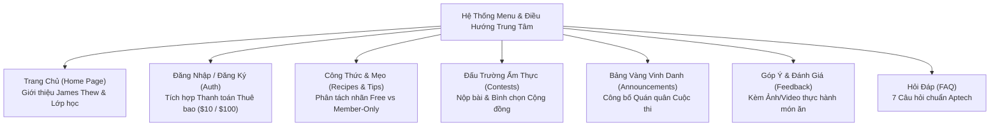

# 📜 ĐẶC TẢ ĐỀ TÀI & BÀN GIAO BÀI TOÁN KINH DOANH (PROJECT TOPIC CHARTER)
## Dự án: Nền Tảng Ẩm Thực & Đấu Trường Nấu Ăn James Thew (James Thew Culinary Portal)
### Chương trình: Aptech Computer Education — eProject Semester 3 (HDSE / ADSE)
> **Chuyên viên Phân tích Nghiệp vụ (Senior Business Analyst):** Lead Systems & Requirements Architect  
> **Căn cứ gốc:** `topic.md` (Đề tài gốc Aptech) · `srs.md` (SRS v2.0 & Microservices Extension) · `rules.md` (10 Luật vàng Kiến trúc) · `c_t_y_u_c_u_h_th_ng_srs_d_n_james_thew_b_n_n_ng_c_p.md` (Review Bảng trắng)  
> **Định hướng Công nghệ Hiện đại:** **Frontend React 19 SPA** + **Backend .NET 10 Microservices** + **Docker & Docker Compose Containerization**.

---

## 📑 MỤC LỤC TỔNG QUAN (INDEX)
1. [Giới thiệu & Triết lý eProject (Introduction)](#1-giới-thiệu--triết-lý-eproject-introduction)
2. [Mục tiêu Dự án (Objectives of the Project)](#2-mục-tiêu-dự-án-objectives-of-the-project)
3. [Mô tả Bài toán Nghiệp vụ & Nhân vật Đại diện (Problem Statement)](#3-mô-tả-bài-toán-nghiệp-vụ--nhân-vật-đại-diện-problem-statement)
4. [Đặc tả Yêu cầu Khách hàng (Customer Requirement Specification - CRS)](#4-đặc-tả-yêu-cầu-khách-hàng-customer-requirement-specification---crs)
5. [Quy chuẩn 3 Nhóm Đối tượng & Ma trận Phân quyền (Actors & RBAC)](#5-quy-chuẩn-3-nhóm-đối-tượng--ma-trận-phân-quyền-actors--rbac)
6. [Nội dung Chuẩn hóa 7 Câu hỏi FAQ Bắt buộc](#6-nội-dung-chuẩn-hóa-7-câu-hỏi-faq-bắt-buộc)
7. [Tiêu chuẩn Thực thi & Kiến trúc Hiện đại (.NET 10 Microservices + Docker + React 19)](#7-tiêu-chuẩn-thực-thi--kiến-trúc-hiện-đại-net-10-microservices--docker--react-19)
8. [Hồ sơ Tài liệu Báo cáo & Sản phẩm Bàn giao (13 Deliverables & Status Emails)](#8-hồ-sơ-tài-liệu-báo-cáo--sản-phẩm-bàn-giao-13-deliverables--status-emails)
9. [Chính sách Sao lưu & Phòng ngừa 3 Rủi ro Thảm họa (Data Backup Policy)](#9-chính-sách-sao-lưu--phòng-ngừa-3-rủi-ro-thảm-họa-data-backup-policy)

---

## 1. GIỚI THIỆU & TRIẾT LÝ EPROJECT (INTRODUCTION)

Nhu cầu học tập, nâng cấp kỹ năng công nghệ và ứng dụng kiến thức vào môi trường doanh nghiệp thực tế với tốc độ cao là đòi hỏi sống còn đối với chuyên gia CNTT ngày nay. Tuy nhiên, lịch trình bận rộn và khoảng cách địa lý thường là rào cản lớn. Vì vậy, Aptech đã tiên phong đưa mô hình **eProject** – môi trường học tập đồng bộ, mô phỏng trực tiếp quy trình phát triển phần mềm chuẩn công nghiệp:

* **Phương pháp tiếp cận bậc thang (Laddered Approach):** Luyện tập và hiện thực hóa từng phân hệ chức năng từ cơ bản đến phức tạp.
* **Xây dựng ứng dụng hoàn chỉnh & bền vững:** Chuyển hóa các bài toán đơn lẻ thành một hệ thống hợp nhất, sẵn sàng chịu tải lớn.
* **Môi trường mô phỏng thực tế (Real-Life Simulation):** Đóng vai trò kỹ sư phần mềm chuyên nghiệp làm việc trực tiếp với khách hàng (Đầu bếp 5 sao James Thew), tiếp nhận yêu cầu, phân tích khoảng cách nghiệp vụ, thiết kế kiến trúc và triển khai code.
* **Tương tác & Cố vấn (Mentoring):** Quy chuẩn trao đổi và giám sát tiến độ thông qua hệ thống báo cáo email định kỳ.

---

## 2. MỤC TIÊU DỰ ÁN (OBJECTIVES OF THE PROJECT)

1. **Mục tiêu Nghiệp vụ (Business Objective):**  
   Xây dựng nền tảng số hóa toàn diện giúp Đầu bếp 5 sao James Thew kết nối với hàng triệu người yêu ẩm thực trên toàn cầu, phân phối nội dung ẩm thực cao cấp, vận hành mô hình kinh doanh thành viên trả phí (Subscription Model: $10/tháng và $100/năm), và tổ chức các đấu trường nấu ăn tương tác cao (Cooking Contests).
2. **Mục tiêu Kỹ thuật (Technical Objective):**  
   Triển khai giải pháp kiến trúc **Microservices** hiện đại trên nền tảng **.NET 10 LTS (C# 14)** và **React 19 SPA**, đóng gói toàn bộ hạ tầng bằng **Docker & Docker Compose**, tuân thủ nghiêm ngặt **10 Luật vàng Kiến trúc tại `rules.md`** và vượt qua 100% các bộ kiểm thử tự động (Unit & Integration Tests).
3. **Mục tiêu Học thuật & Bàn giao (Deliverable Objective):**  
   Hoàn thiện toàn bộ bộ hồ sơ 13 hạng mục báo cáo Aptech eProject Sem 3, gửi đầy đủ các email trạng thái đúng format và tuân thủ chính sách sao lưu dự phòng.

---

## 3. MÔ TẢ BÀI TOÁN NGHIỆP VỤ & NHÂN VẬT ĐẠI DIỆN (PROBLEM STATEMENT)

### 3.1. Nhân vật Đại diện: Chef James Thew
* **Vị thế:** Bếp trưởng điều hành (Executive Chef) tại khách sạn 5 sao danh tiếng trong thành phố.
* **Tầm ảnh hưởng:** Tác giả của nhiều cuốn sách dạy nấu ăn bán chạy; khách mời thường xuyên của các chương trình truyền hình ẩm thực lớn; chuyên gia về 4 trường phái ẩm thực cốt lõi:
  1. **Nước ép & Thức uống dinh dưỡng (Juices)**
  2. **Món mặn cao cấp (Non-Vegetarian Recipes)**
  3. **Món chay thanh tịnh (Vegetarian Recipes)**
  4. **Ẩm thực Ý cổ điển & hiện đại (Italian Cuisine)**
* **Hoạt động cộng đồng:** Mở các lớp dạy nấu ăn thực tế vào cuối tuần gần nhà với mức học phí tượng trưng cực thấp nhằm tiếp cận và truyền cảm hứng cho **tệp khán giả đại chúng (Mass Audience)**.

### 3.2. Nhu cầu Chuyển đổi Số hóa
Chef James Thew nhận thấy các lớp học trực tiếp bị giới hạn về không gian địa lý. Ông mong muốn sở hữu một **Cổng thông tin Ẩm thực Trực tuyến Toàn cầu** để:
* Xuất bản các công thức nấu ăn độc quyền và mẹo làm bếp chuyên nghiệp.
* Thu hút độc giả đại chúng bằng nội dung miễn phí, đồng thời chuyển đổi họ thành **Thành viên VIP trả phí**.
* Tổ chức các cuộc thi nấu ăn trực tuyến định kỳ, thu hút bài dự thi từ cả thành viên lẫn khách vãng lai, tạo sân chơi bình chọn tương tác sôi nổi.
* Lắng nghe ý kiến đóng góp, phản hồi thành phẩm từ cộng đồng để không ngừng hoàn thiện nghệ thuật ẩm thực.

---

## 4. ĐẶC TẢ YÊU CẦU KHÁCH HÀNG (CUSTOMER REQUIREMENT SPECIFICATION - CRS)

### 4.1. Cấu trúc Menu & Trang Chính của Hệ thống



1. **Trang Chủ (Home Page):**  
   Hiển thị hồ sơ chi tiết của chủ sở hữu website (Mr. James Thew), tiểu sử 5 sao, lịch trình lớp học cuối tuần, các chương trình phát sóng (Talkshow/Liveshow), danh sách công thức miễn phí nổi bật và cuộc thi đang mở.
2. **Đăng nhập & Đăng ký Thành viên (Login / Register):**  
   Khách hàng chỉ được kích hoạt tài khoản thành viên khi thực hiện thanh toán một trong hai gói cước cố định:
   - **Gói Tháng (Monthly Subscription):** `$10 USD` (Thời hạn 30 ngày).
   - **Gói Năm (Yearly Subscription):** `$100 USD` (Thời hạn 365 ngày).
3. **Công Thức & Mẹo Nấu Ăn (Recipes & Tips):**  
   - Người chưa đăng ký chỉ xem và tìm kiếm các bài viết được đánh dấu **Miễn phí (`IsFree = true`)**.
   - Thành viên VIP và Admin có toàn quyền truy cập 100% công thức độc quyền và mẹo bếp chuyên sâu.
   - Mỗi công thức bắt buộc gồm đủ 3 thành phần: **Tên món (`Title`)**, **Danh sách nguyên liệu (`Ingredients`)**, và **Quy trình chế biến (`CookingProcedure`)**.
4. **Cuộc Thi Ẩm Thực (Contests):**  
   - Ông James Thew tạo cuộc thi (yêu cầu nộp Recipe hoặc nộp Tip) kèm thời hạn và giải thưởng.
   - Cả **Thành viên** lẫn **Khách vãng lai (Guest - không cần tài khoản)** đều được phép nộp bài dự thi. Nếu là Guest, hệ thống bắt buộc lưu `GuestName` và `GuestEmail` để trao giải.
   - Cộng đồng tham gia **Bình chọn (Community Vote)** để vinh danh bài thi xuất sắc.
5. **Thông Báo Quán Quân (Announcements):**  
   Sau khi rà soát bài dự thi và tham khảo kết quả bình chọn, Chef James Thew trực tiếp công bố người thắng giải lên trang Announcements.
6. **Đánh Giá & Phản Hồi (Feedback):**  
   Cho phép người dùng gửi góp ý chung về website hoặc gửi đánh giá trực tiếp dưới từng công thức nấu ăn (kèm hình ảnh/video kết quả thực hành).
7. **Trang Hỏi Đáp (FAQ’s):**  
   Hiển thị chính xác 7 câu hỏi thường gặp cố định theo quy định đề bài Aptech.

---

## 5. QUY CHUẨN 3 NHÓM ĐỐI TƯỢNG & MA TRẬN PHÂN QUYỀN (ACTORS & RBAC)

| Chức năng Nghiệp vụ | Khách Vãng Lai (`GUEST`) | Thành Viên Trả Phí (`MEMBER`) | Bếp Trưởng Quản Trị (`ADMIN`) |
| :--- | :---: | :---: | :---: |
| **Xem Trang chủ, Tiểu sử James Thew, Lịch lớp học** | ✅ Có | ✅ Có | ✅ Có |
| **Đăng ký tài khoản kèm Thanh toán ($10 / $100)** | ✅ Có | *(Đã có tài khoản)* | *(Tài khoản vĩnh viễn)* |
| **Xem & Chỉnh sửa Hồ sơ cá nhân (User Profile trực tiếp)** | ❌ Không | ✅ Có (Sửa ngay trên trang) | ✅ Có (Sửa ngay trên trang) |
| **Xem công thức & mẹo Miễn phí (`IsFree = true`)** | ✅ Có | ✅ Có | ✅ Có |
| **Xem công thức & mẹo VIP (`IsFree = false`) + Video/Live** | ❌ Bị chặn (Yêu cầu $10) | ✅ Toàn quyền truy cập | ✅ Toàn quyền truy cập |
| **Tìm kiếm công thức & mẹo trực tuyến** | Chỉ tìm trong bài Free | Tìm toàn bộ hệ sinh thái | Tìm toàn bộ hệ sinh thái |
| **Đăng tải công thức & mẹo mới cá nhân** | ❌ Không (Trừ thi Contest) | ✅ Đăng bài của mình | ✅ Đăng bài kèm nhãn Free/Paid |
| **Sửa / Xóa công thức & mẹo đã đăng** | ❌ Không | ✅ Chỉ sửa/xóa bài của chính mình | ✅ Sửa/xóa bài của Admin & Kiểm duyệt |
| **Đánh dấu cờ Miễn phí (`IsFree`)** | ❌ Không | ❌ Mặc định hệ thống | ✅ Duy nhất Admin có quyền |
| **Xem danh sách cuộc thi đang mở** | ✅ Có | ✅ Có | ✅ Có |
| **Nộp bài dự thi Contest (Recipe / Tip)** | ✅ Có (Nhập Tên + Email) | ✅ Có (Dùng tài khoản) | ❌ Không (Là người chấm) |
| **Tham gia Bình chọn bài thi (Community Vote)** | ✅ Có (Chống spam IP/Email) | ✅ Có (1 vote/user) | ✅ Có |
| **Tạo mới hoặc Xóa cuộc thi ẩm thực** | ❌ Không | ❌ Không | ✅ Toàn quyền |
| **Xem toàn bộ danh sách bài thi (Posts) của cuộc thi** | ❌ Không | ❌ Không | ✅ Toàn quyền |
| **Chấm giải & Xuất bản Thông báo Người thắng cuộc** | ❌ Không | ❌ Không | ✅ Toàn quyền |
| **Xem trang Thông báo (Announcements)** | ✅ Có | ✅ Có | ✅ Có |
| **Gửi Phản hồi (Feedback) cho công thức & website** | ✅ Có | ✅ Có | ✅ Có |
| **Xem toàn bộ danh sách Feedback đã nhận** | ❌ Không | ❌ Không | ✅ Toàn quyền |
| **Xem 7 câu hỏi thường gặp (FAQ)** | ✅ Có | ✅ Có | ✅ Có |

---

## 6. NỘI DUNG CHUẨN HÓA 7 CÂU HỎI FAQ BẮT BUỘC

Trang FAQ phải hiển thị đầy đủ, chính xác 7 câu hỏi tiếng Anh theo quy định Aptech eProject kèm giải đáp song ngữ:

1. **How to become the member of this site?**  
   *(Làm thế nào để trở thành thành viên của trang web?)*  
   👉 **Trả lời:** Truy cập trang `Login / Register`, điền thông tin tài khoản và hoàn tất thanh toán gói thuê bao ($10/tháng hoặc $100/năm). Tài khoản của bạn sẽ được kích hoạt tức thì.
2. **Will there be any subscription charges?**  
   *(Có bất kỳ khoản phí đăng ký nào không?)*  
   👉 **Trả lời:** Có. Website áp dụng 2 gói thành viên linh hoạt: Gói Tháng là `$10 USD` (30 ngày) và Gói Năm là `$100 USD` (365 ngày).
3. **How to view the recipes and tips? Will there be any charges for that?**  
   *(Làm thế nào để xem công thức và mẹo? Có mất phí không?)*  
   👉 **Trả lời:** Khách vãng lai được xem hoàn toàn miễn phí tất cả các công thức và mẹo có nhãn `Free`. Để xem các công thức bí truyền 5 sao, video độc quyền và livestream của Chef James Thew, bạn cần đăng ký gói thành viên trả phí.
4. **I am not the registered member of the site. Can I participate in the contest held?**  
   *(Tôi không phải là thành viên đã đăng ký. Tôi có thể tham gia cuộc thi được tổ chức không?)*  
   👉 **Trả lời:** **Có!** Chef James Thew khuyến khích toàn thể cộng đồng tham gia. Khách vãng lai có thể gửi bài dự thi mà không cần đăng ký tài khoản (chỉ cần cung cấp Họ tên và Email liên hệ khi nộp bài).
5. **How to upload or post the recipes and tips?**  
   *(Làm thế nào để tải lên hoặc đăng công thức và mẹo?)*  
   👉 **Trả lời:** Đăng nhập tài khoản Thành viên, truy cập mục `My Submissions` (hoặc `Manage Recipes & Tips`), bấm nút đăng bài mới, điền tên món, danh sách nguyên liệu và quy trình các bước nấu.
6. **How to post a feedback?**  
   *(Làm thế nào để gửi phản hồi?)*  
   👉 **Trả lời:** Bạn có thể gửi phản hồi trực tiếp tại khung `Feedback & Comments` ở chân mỗi trang chi tiết công thức (có thể đính kèm ảnh/video thành phẩm món ăn bạn đã thực hành), hoặc gửi góp ý chung về hệ thống tại trang `Site Feedback`.
7. **I have posted a recipe or a tip with respect to the contest. How can I know who is the winner?**  
   *(Tôi đã đăng công thức/mẹo dự thi. Làm sao tôi biết ai là người chiến thắng?)*  
   👉 **Trả lời:** Sau khi kết thúc thời gian bình chọn và chấm giải, Chef James Thew sẽ vinh danh Quán quân trên trang `Announcements`. Đồng thời hệ thống sẽ tự động gửi email chúc mừng tới địa chỉ email bạn đã cung cấp khi nộp bài.

---

## 7. TIÊU CHUẨN THỰC THI & KIẾN TRÚC HIỆN ĐẠI (.NET 10 MICROSERVICES + DOCKER + REACT 19)

### 7.1. Hiện đại hóa Nền tảng Công nghệ (Tech Stack Evolution)
Mặc dù đề bài Aptech gốc liệt kê các công nghệ thế hệ trước (Pentium 166, Windows 98, JSP/Servlet, SQL Server 2000), theo quy định đồ án tiên tiến, dự án được hiện thực hóa trên nền tảng **Enterprise Cloud-Native** chuẩn công nghiệp:

* **Giao diện Người dùng (Frontend):**  
  **React 19 SPA** + Vite 8 + React Router Dom v7 + Lucide Icons + Bộ thiết kế *5-Star Luxury Architectural Theme* (EB Garamond, Warm Alabaster `#fdfbf7`, Deep Charcoal `#1a1a1a`, Fine Gold `#b69355`).
* **Hệ thống Xử lý Nghiệp vụ (Backend):**  
  **ASP.NET Core Web API (.NET 10 LTS - `net10.0`, C# 14)**, áp dụng Clean Architecture, Repository Pattern và Unit of Work.
* **Cơ sở Dữ liệu & Caching:**  
  **Microsoft SQL Server 2022** (Code-First EF Core 10) + **Redis Caching** (cho công thức Free, FAQ và bộ đếm Vote).

---

### 7.2. Kiến trúc Vi Dịch Vụ (Microservices Topology)
Hệ thống được chia tách thành **7 Microservices độc lập**, tuân thủ nguyên tắc **Database-per-Service** (cấm mọi cross-DB join theo `rules.md`):

```
                                [ CLIENT: React 19 SPA ]
                                            │ (HTTP / JSON / WSS)
                                            ▼
                    ┌───────────────────────────────────────────────┐
                    │    API GATEWAY & REVERSE PROXY (YARP .NET)    │
                    │   - Port: 8000 (Host)                         │
                    │   - JWT Introspection & RBAC Header Injection │
                    │   - Content Gatekeeping (Rule 3 Enforcement)  │
                    │   - Rate Limiting & SSL Termination           │
                    └───────────────────────┬───────────────────────┘
                                            │ Internal Network
        ┌───────────────┬───────────────────┼───────────────────┬───────────────┐
        ▼               ▼                   ▼                   ▼               ▼
┌──────────────┐ ┌──────────────┐   ┌──────────────┐    ┌──────────────┐ ┌──────────────┐
│  Identity &  │ │ Subscription │   │   Culinary   │    │  Contest &   │ │ Community &  │
│Profile Service│ │Billing Service│   │Catalog Service│    │ Gamification │ │Feedback Svc  │
│ (Port 5001)  │ │ (Port 5002)  │   │ (Port 5003)  │    │ (Port 5004)  │ │ (Port 5005)  │
│ [DB: Users]  │ │[DB: Payments]│   │[DB: Recipes] │    │[DB: Contests]│ │[DB: Feedbacks│
└───────┬──────┘ └──────┬───────┘   └───────┬──────┘    └──────┬───────┘ └──────┬───────┘
        │               │                   │                  │                │
        └───────────────┼───────────────────┼──────────────────┼────────────────┘
                        ▼                   ▼                  ▼
                ┌───────────────────────────────────────────────────────┐
                │        MESSAGE BROKER BACKBONE (RabbitMQ / Kafka)      │
                │     - SubscriptionActivatedEvent                      │
                │     - ContestWinnerAnnouncedEvent                     │
                │     - RecipePublishedEvent                            │
                └───────────────────────────┬───────────────────────────┘
                                            │
                        ┌───────────────────┴───────────────────┐
                        ▼                                       ▼
            ┌──────────────────────┐                ┌──────────────────────┐
            │   Media & Streaming  │                │    Notification &    │
            │   Service (Port 5006)│                │  Messaging Service   │
            │ [S3 / Cloudinary]    │                │ (Port 5007 - SignalR)│
            └──────────────────────┘                └──────────────────────┘
```

---

### 7.3. Đóng Gói Containerization với Docker & Docker Compose
Toàn bộ hệ thống được container hóa đồng bộ, khởi chạy chỉ với một câu lệnh: `docker compose up --build`:

* **Multi-stage Dockerfile chuẩn .NET 10:**  
  Sử dụng image base tối ưu `mcr.microsoft.com/dotnet/aspnet:10.0-alpine` (hoặc Chiseled Ubuntu), bảo đảm kích thước image siêu nhẹ (< 120MB) và bảo mật cao (chạy dưới non-root user).
* **Multi-stage Dockerfile cho Frontend:**  
  Build source React 19 bằng `node:20-alpine`, sau đó đóng gói production bundle vào `nginx:alpine` phục vụ file tĩnh và proxy API.
* **Cấu hình `docker-compose.yml` Hợp Nhất:**
  - `gateway`: YARP API Gateway (Port `8000:8000`).
  - `frontend`: React SPA Nginx (Port `3000:80`).
  - `service-identity`: .NET 10 API (Port `5001`).
  - `service-subscription`: .NET 10 API (Port `5002`).
  - `service-catalog`: .NET 10 API (Port `5003`).
  - `service-contest`: .NET 10 API (Port `5004`).
  - `service-community`: .NET 10 API (Port `5005`).
  - `service-media`: .NET 10 API (Port `5006`).
  - `service-notification`: .NET 10 API + SignalR Hub (Port `5007`).
  - `sqlserver`: Microsoft SQL Server 2022 (Port `1433`).
  - `redis`: Redis 7-alpine (Port `6379`).
  - `rabbitmq`: RabbitMQ 3.13-management (Port `5672`, `15672`).

---

## 8. HỒ SƠ TÀI LIỆU BÁO CÁO & SẢN PHẨM BÀN GIAO (13 DELIVERABLES & STATUS EMAILS)

Theo quy chế Aptech eProject Sem 3, hồ sơ đồ án bàn giao bắt buộc phải chứa trọn vẹn 13 mục và quy trình liên lạc chuẩn:

### 8.1. Danh mục 13 Hồ sơ Đồ án (Project Report Dossier)
1. **Certificate of Completion:** Chứng nhận hoàn thành đồ án eProject.
2. **Table of Contents:** Mục lục chi tiết.
3. **Problem Definition:** Định nghĩa bài toán và mô hình kinh doanh Chef James Thew.
4. **Customer Requirement Specification (CRS):** Đặc tả yêu cầu khách hàng.
5. **Project Plan:** Kế hoạch thực hiện dự án và ma trận quản trị rủi ro.
6. **E-R Diagrams (ERD):** Sơ đồ thực thể liên kết (11 bảng cốt lõi và quan hệ dữ liệu).
7. **Algorithms & Flowcharts:** Thuật toán đăng ký thanh toán, gatekeeping bài viết, chấm giải & bình chọn.
8. **GUI Standards Document:** Tiêu chuẩn giao diện Luxury Architectural 5 sao.
9. **Interface Design Document:** Tài liệu thiết kế wireframes các màn hình chính.
10. **Task Sheet:** Bảng phân chia công việc chi tiết cho 4 thành viên.
11. **Project Review and Monitoring Report:** Báo cáo đánh giá và theo dõi tiến độ qua 3 mốc.
12. **Unit Testing Check List:** Danh sách ca kiểm thử đơn vị (100% tỷ lệ vượt qua).
13. **Final Check List:** Danh mục kiểm tra nghiệm thu cuối cùng trước khi bảo vệ.

### 8.2. Quy định Gửi Email Báo cáo Trạng thái (Deliverable Status Emails)
* Nhóm bắt buộc gửi **02 email báo cáo trạng thái (`STATUS:`)**:
  - Email 1: Giữa ngày 7 – 10 kể từ ngày khởi động.
  - Email 2: Trước ngày kết thúc dự án 3 ngày.
* Tiêu đề email bắt buộc tuân theo tiền tố chuẩn Aptech:
  - `STATUS: [eProject Sem 3 - Group 04] - Milestone 1 Progress Report`
  - `STATUS: [eProject Sem 3 - Group 04] - Milestone 2 Progress Report`
  - `DOUBT: [Vấn đề thắc mắc cần trợ giúp]`
  - `PROJECT SUBMISSION: [eProject Sem 3 - Group 04] - Final Deliverable Package & Project Dossier`

---

## 9. CHÍNH SÁCH SAO LƯU & PHÒNG NGỪA 3 RỦI RO THẢM HỌA (DATA BACKUP POLICY)

Đề tài Aptech nhấn mạnh việc sao lưu dữ liệu là kỷ luật bắt buộc trong quản trị dự án phần mềm nhằm ngăn chặn tuyệt đối **3 nguy cơ thảm họa**:
1. **Virus problem (Sự cố lây nhiễm mã độc/virus):** Cô lập môi trường phát triển, quét virus định kỳ máy trạm.
2. **System failure (Lỗi sập hệ thống/phần cứng):** Triển khai container hóa Docker để có thể phục hồi toàn bộ hệ sinh thái trên bất kỳ máy chủ nào trong vòng 3 phút.
3. **File corrupt (Hư hỏng tệp tin/mất mát mã nguồn):**
   - **Kỷ luật Git:** Thực hiện commit và push mã nguồn lên GitHub/GitLab từ xa cuối mỗi ngày làm việc.
   - **Kỷ luật Database:** Tạo bản export script `.sql` hoặc `.bak` hàng ngày đối với cơ sở dữ liệu SQL Server.

---

> [!NOTE]
> **Tuyên ngôn của Senior BA:**  
> Bản đặc tả đề tài `topic.md` này là **"Kim chỉ nam" (North Star)** thống nhất toàn bộ tư duy bài toán, yêu cầu nghiệp vụ của Chef James Thew và chuẩn mực kỹ thuật hiện đại (.NET 10 Microservices + Docker + React 19). Mọi thành viên trong nhóm và các công cụ hỗ trợ phát triển bắt buộc bám sát tài liệu này để triển khai mã nguồn và hoàn thiện hồ sơ đồ án.
